# Awaaz

**Ordinary phone calls for people who can’t hear or speak.**

Awaaz lets someone who is deaf, hard of hearing, or unable to speak make a normal phone call. They type (or speak into the mic, or tap a phrase) and Awaaz says it aloud on the call. What the other person says appears on screen as live captions, in the language the user reads. The person on the other end just hears an ordinary call, with a short opening line telling them an assistant is helping.

| | |
|---|---|
| **Live demo** | https://awaazai.amitpile.com |
| **Try it first** | Sign in, then use **Practice calls** on the Calls screen. They need no phone number and work for everyone. |
| **Real phone calls** | Work only for numbers verified in Bolna. See [Try a real call](#try-a-real-call-verified-numbers-only). |

<p>
  
  
  
  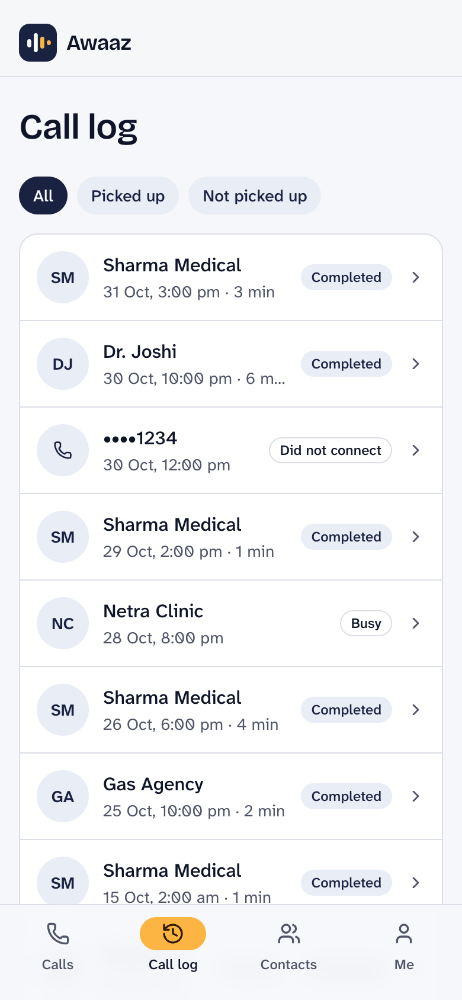
</p>

---

## Contents
1. [The problem](#the-problem)
2. [What Awaaz does](#what-awaaz-does)
3. [Screens](#screens)
4. [Features](#features)
5. [Try it](#try-it)
6. [How it works](#how-it-works)
7. [Rules the product keeps](#rules-the-product-keeps)
8. [Tech stack](#tech-stack)
9. [Run it yourself](#run-it-yourself)
10. [Testing](#testing)
11. [Deployment and operations](#deployment-and-operations)
12. [Project layout and docs](#project-layout-and-docs)
13. [Known limits](#known-limits)
14. [Work in progress and future scope](#work-in-progress-and-future-scope)

---

## The problem

The phone call is still how everyday business gets done in India: the pharmacy that confirms a medicine, the bank that verifies a payment, the clinic that gives an appointment time, the gas agency that books a cylinder. Most of these places do not use chat, email or video.

For someone who can’t hear or can’t speak, a phone call is closed off:
- They cannot follow what is said, or cannot answer.
- They depend on a family member or neighbour to call for them, which costs privacy and independence. A medical or banking call is the worst one to hand to someone else.
- They are easy targets for phone scams. The scammer’s urgency and tone go unheard, and an OTP read out loud is gone.

Millions of people in India live with a hearing or speech disability. Census 2011 counted roughly 5 million with a hearing disability and 2 million with a speech disability, and WHO-based estimates of significant hearing loss are much higher. These are approximate figures from memory and should be checked against the sources before quoting them. Text relay services exist in some countries, but to our knowledge there is no widely available, free, Indian-language equivalent that works with an ordinary phone number at the other end.

**The cause is simple: the other end of the line has not changed, and it won’t.** The pharmacy is not going to install an app. So the fix has to live entirely on the caller’s side, and the call has to look normal to everyone else.

## What Awaaz does

Awaaz sits between the user and the person they are calling:

1. The user opens Awaaz and starts a call. The screen says **Connecting…**, then **Calling…** while it rings.
2. When the other person **picks up**, the screen says **Connected** and Awaaz says a short opening line: *an assistant is helping this person, please speak slowly.*
3. Everything the other person says is turned into **live captions**, in the user’s chosen language, with prices, times and numbers highlighted.
4. The user answers by **typing**, **speaking into the mic**, tapping a **saved phrase** or a **smart reply**, or using **Help me say it** (a few words become a clear sentence the user approves first). Awaaz speaks it on the call.
5. If the call does not connect, the screen says why: the line is busy, no answer, or they declined.
6. After the call, the user gets a **summary** (what was agreed and the numbers to remember), and the call is kept in the **Call log**.

It is not a chatbot and it does not talk for the user. Nothing is said on the call unless the user does something.

## Screens

Every screenshot is one phone screen. Arrows show the order you see them in; a long screen is shown in parts as you scroll (for example *1 of 3*). All names, numbers and conversations are fictional.

### 1. Getting started

<table>
  <tr>
    <td align="center" valign="top" width="170"><br><sub>Sign in</sub></td>
    <td align="center" valign="middle">→</td>
    <td align="center" valign="top" width="170">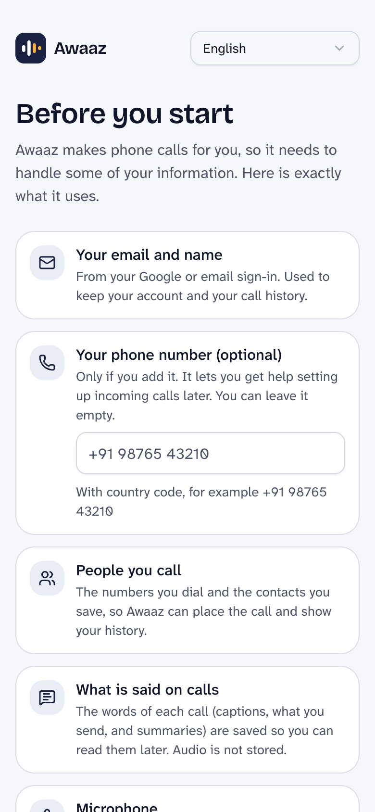<br><sub>Before you start (1 of 2)</sub></td>
    <td align="center" valign="middle">→</td>
    <td align="center" valign="top" width="170">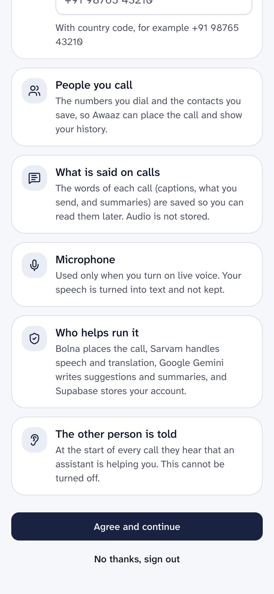<br><sub>Before you start (2 of 2)</sub></td>
    <td align="center" valign="middle">→</td>
    <td align="center" valign="top" width="170"><br><sub>Pick a language</sub></td>
  </tr>
</table>

<table>
  <tr>
    <td align="center" valign="top" width="170"><br><sub>Name, gender, profile</sub></td>
    <td align="center" valign="middle">→</td>
    <td align="center" valign="top" width="170">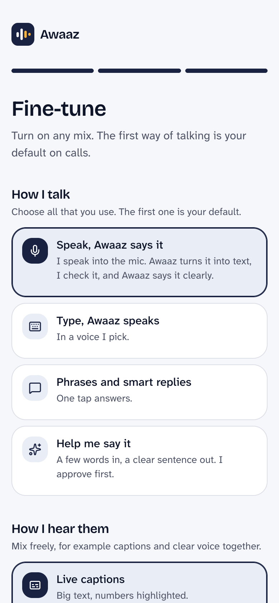<br><sub>Fine-tune (1 of 3)</sub></td>
    <td align="center" valign="middle">→</td>
    <td align="center" valign="top" width="170">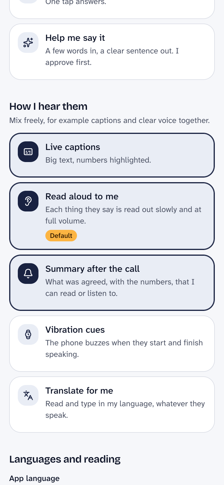<br><sub>Fine-tune (2 of 3)</sub></td>
    <td align="center" valign="middle">→</td>
    <td align="center" valign="top" width="170">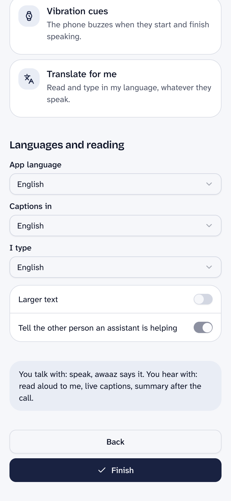<br><sub>Fine-tune (3 of 3)</sub></td>
  </tr>
</table>

### 2. Making a call

<table>
  <tr>
    <td align="center" valign="top" width="170"><br><sub>Dashboard</sub></td>
    <td align="center" valign="middle">→</td>
    <td align="center" valign="top" width="170">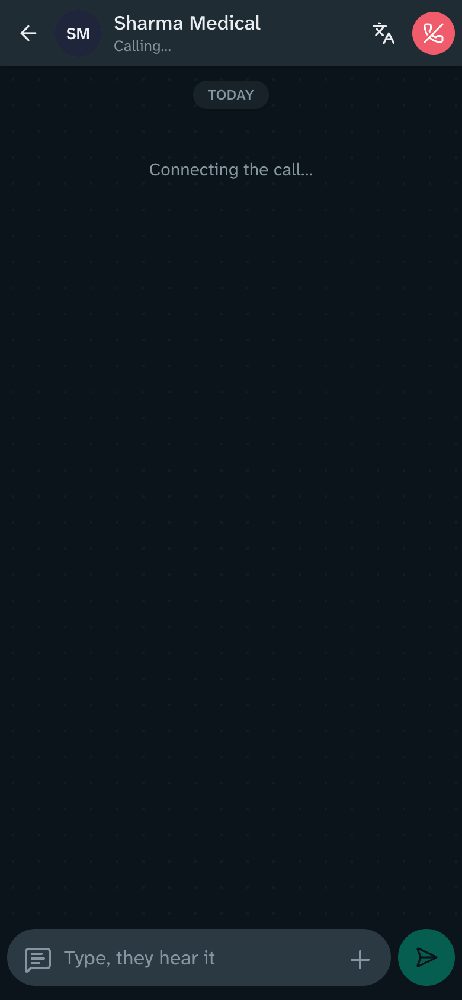<br><sub>Calling…</sub></td>
    <td align="center" valign="middle">→</td>
    <td align="center" valign="top" width="170"><br><sub>Connected: live captions</sub></td>
    <td align="center" valign="middle">→</td>
    <td align="center" valign="top" width="170"><br><sub>Scam warning</sub></td>
  </tr>
</table>

### 3. When a call does not connect, and afterwards

<table>
  <tr>
    <td align="center" valign="top" width="170">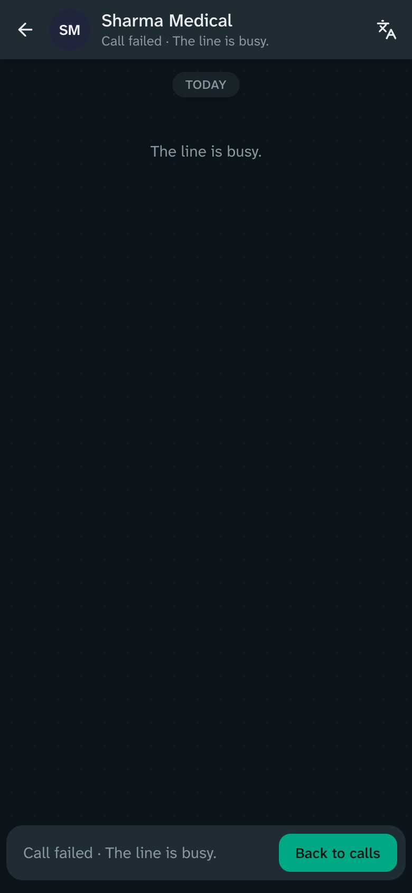<br><sub>Line busy (or no answer, or declined)</sub></td>
    <td align="center" valign="middle">→</td>
    <td align="center" valign="top" width="170"><br><sub>Call log</sub></td>
    <td align="center" valign="middle">→</td>
    <td align="center" valign="top" width="170">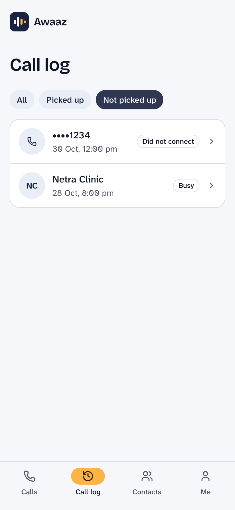<br><sub>Filter: not picked up</sub></td>
    <td align="center" valign="middle">→</td>
    <td align="center" valign="top" width="170"><br><sub>Summary after the call</sub></td>
  </tr>
</table>

### 4. Everyday use

<table>
  <tr>
    <td align="center" valign="top" width="170"><br><sub>Contacts</sub></td>
    <td width="16"></td>
    <td align="center" valign="top" width="170">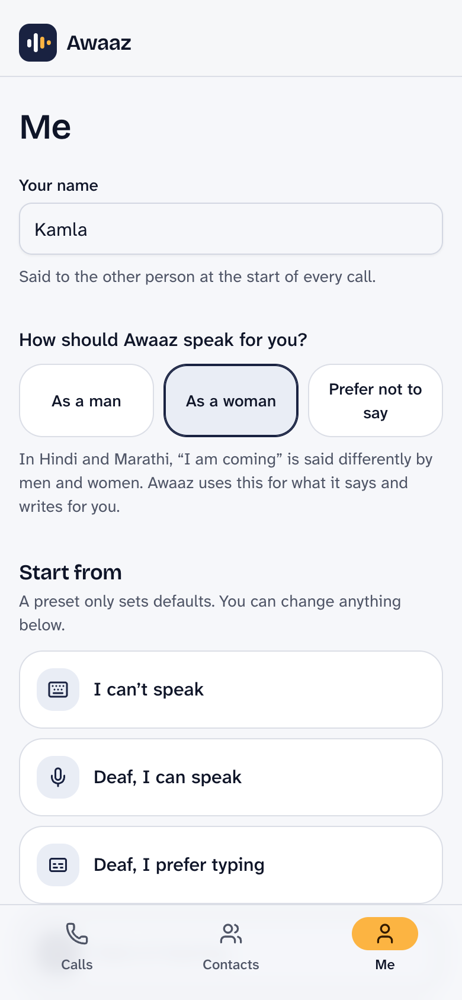<br><sub>Me (1 of 2)</sub></td>
    <td align="center" valign="middle">→</td>
    <td align="center" valign="top" width="170">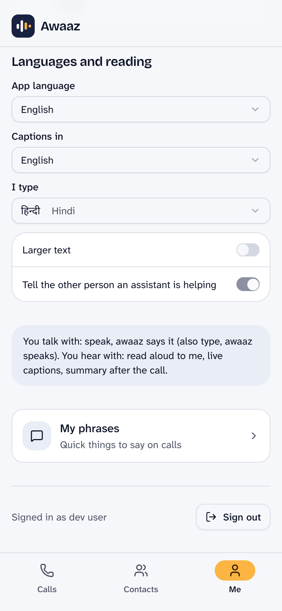<br><sub>Me (2 of 2)</sub></td>
    <td width="16"></td>
    <td align="center" valign="top" width="170"><br><sub>The app in Tamil</sub></td>
  </tr>
</table>

The app is available in 12 languages; Tamil is shown above. Four tabs sit at the bottom of the phone (or along the top on a computer): **Calls**, **Call log**, **Contacts** and **Me**.

## Features

**Dashboard and call log**
- **Stat cards for the last 7 days**: calls made (with when the last one was), total talk time (with the average call), the share of calls that were picked up (“4 of 6 calls”), and the contact called most.
- Practice calls and tasks are left out of the numbers, because they are not real conversations. The stats use the 200 most recent calls.
- Favourites (one tap to call) and Practice calls sit below the stats. A new account sees a short “No calls yet” prompt instead of empty cards.
- **Call log tab**: every call, newest first, with who, when, how long and how it went (completed, busy, no answer, did not connect). Filters for *All*, *Picked up* and *Not picked up*. Practice calls carry a tag. Tapping a call opens its transcript and summary.

**Making a call**
- Outbound calls through a real phone line (Bolna), with a spoken opening line on every call.
- **Honest call progress.** *Connecting…* while the call is placed, *Calling…* while it rings, *Connected* with a running timer only once the other person picks up (taken from Bolna’s own status updates, with their first words as a backup signal). The opening-line bubble appears at that moment, not before.
- **Says why a call did not connect**: the line is busy, no answer, or they declined, in the user’s language. The End button is there from the first second, including while it connects.
- **End call hangs up properly.** The user’s End tap closes the call in the app at once, asks Bolna to stop a call that has not started ringing, and for a call already in progress says a short goodbye in the call language so the other person is told the call is over (see [Ending a call](#ending-a-call)).
- **Practice calls**: scripted callers (a Hindi pharmacy, a Marathi clinic, a bank-scam caller) that need no phone. Smart replies, translation and drafts run live in them.
- Keypad for phone menus (“press 1 for…”), “Ask again” to ask the other person to repeat, a confirm step before ending a call.
- Daily and per-call minute limits, and one live call per user at a time.
- If the server restarts during a call, the app is told the call ended instead of showing “Reconnecting…” for ever, and the call record is closed (see [Deployment and operations](#deployment-and-operations)).

**Talking: choose any mix**
- **Type, and Awaaz speaks.** Typing in Hindi, Marathi or English works; text in the call’s own script is spoken straight away.
- **Phrases and smart replies.** Saved phrases, plus one-tap suggested answers after the other person speaks.
- **Help me say it.** A few words in, a clear sentence out. The user approves it before it is spoken.
- **Live voice: speak, Awaaz says it.** Tap the mic and talk normally. The microphone is streamed to speech-to-text, and the recognised phrases are gathered into **one message after a real pause** (about 1.8 seconds of quiet), so a breath in the middle of a sentence no longer splits it in two. Starting to speak again keeps the message open; stopping the mic sends what was heard; a long speech is sent in chunks at most 10 seconds apart. A switch lets the user check each message before it is sent instead (then phrases are added to the text box, not replacing it). If the speech service drops the connection, it reconnects by itself.
- Typing in any Indian script with the phone’s own keyboard. If the user types in English letters, Awaaz offers the same text in their own script.
- Text typed in a different language than the call’s is translated, shown, and spoken only after the user confirms.
- **Sending feels instant.** A message appears the moment it is sent, and Awaaz prepares it (script conversion, translation) while the user is still typing, so it is usually ready by the time they press send.
- **Messages sent together are spoken together.** Messages sent within a fraction of a second of each other go out as one reply, in order. A message sent later waits until the other person speaks again, and the chat says so (see [Why one reply per turn](#why-one-reply-per-turn)).
- **Speaks the way the user would.** Hindi and Marathi verbs change for men and women; onboarding asks how Awaaz should speak for the user (as a man, as a woman, or prefer not to say). Opening lines are gender-neutral unless the user chooses, and drafts, smart replies and translations follow the choice.

**Hearing: choose any mix**
- **Live captions** with big text, and prices, times and numbers highlighted.
- **Translate for me.** Captions appear in the call’s language first, then the user’s language follows underneath, with the original always kept in view.
- **Switch the caption language during the call** from a one-tap list. The last few captions are translated again, translations are remembered per language (switching back is instant), and lines still being translated say “Translating to …”.
- **Read aloud.** Each thing the other person says is read out slowly in their exact words.
- **Vibration cues** when the other person starts and stops speaking (Android and desktop Chrome).
- **Summary after the call**: what was agreed, key numbers, next steps, and a Listen button.

**The call chat (WhatsApp-style)**
- Built to feel like WhatsApp: your messages in green bubbles on the right, theirs on the left, a pointed tail on the first bubble of each run, a “Today” divider, and the time inside every bubble.
- Ticks show what happened to each message: a clock while it is being sent, a blue double tick once it has been said on the call.
- The header shows the call state (*Connecting…*, *Calling…*, then “Connected · 1:42” with a timer, and “speaking…” while the other person talks), with buttons for the caption language and ending the call.
- The input bar grows with the message, the round button is the mic when the box is empty and send when it has text, and the keyboard stays open after sending. **Enter sends on a computer** (any device with a mouse or trackpad, including touchscreen laptops) and adds a line on a phone.
- While recording, the bar shrinks to fit so the **stop button always stays on screen**, even on a narrow phone or with a long label in another language.
- The screen sizes itself to the visible area, so the on-screen keyboard never covers the input bar, and quick replies sit above the input bar instead of over it.
- If you scroll up to read, new captions do not pull you down; a button shows how many new lines arrived.
- Tap a bubble to copy it, have it read aloud, or say it again.
- Phrases are one tap from the input bar; the “+” opens the keypad, “Ask again”, Help me say it and the caption language.

**Safety**
- **Scam shield.** When someone asks for an OTP, PIN, UPI PIN, CVV or to install a remote-access app, Awaaz shows a red warning, refuses to speak any 4–8 digit number on that call, and logs the event.
- **Scam openers are flagged too.** Calls that say a card, account, SIM or electricity will be blocked, mention KYC, a lottery or a refund, pretend to be a bank, police or courier, or push a link get a “This call may be a scam” warning before anyone asks for a code. Numbers are not read out from then on, and a later code request shows its own warning.
- An opening line on every call says an assistant is helping. This cannot be turned off.
- AI-drafted and translated text is shown first and spoken only after the user confirms.
- Sign-in tokens and webhook secrets are kept out of the server logs, and phone numbers are masked.

**Languages**
- The whole app in **12 languages**: English, Hindi, Hinglish (Hindi in English letters), Marathi, Bengali, Tamil, Telugu, Kannada, Gujarati, Punjabi, Malayalam and Odia.
- Language is the first onboarding question and can be changed any time, including on the login screen.
- The language the other person speaks is set per contact or when starting a call.
- The 11 non-English translations are machine-made and still need a native-speaker review. A test checks that every language file has exactly the same keys as English.

**Account and settings**
- Sign in with Google or with email and password, followed by a one-time screen that says what is collected and asks for consent (stored with a version, so people are asked again if it changes).
- Six starting profiles (for example “Deaf, I prefer typing”, “Hard of hearing”, “I can’t speak”), then fine-tune each option.
- Profile changes (larger text, speech rate, app language, gender) save reliably and apply straight away; a save that loses its reply is checked with the server before an error is shown.
- Contacts with favourites and notes that smart replies can use (“my BP medicine is Telma 40”).
- Installable as a web app, light and dark themes, larger-text option.

## Try it

### Practice calls (everyone, no phone needed)
1. Open **https://awaazai.amitpile.com**. The first load can take up to a minute, because the free server sleeps when idle.
2. Sign in with Google, or create an account with email and password. The first time, a **“Before you start”** screen lists exactly what Awaaz collects (email and name, an optional phone number, the numbers you call, call text; audio is not stored) and asks you to agree.
3. Choose your language, enter your name, choose how Awaaz should speak for you, and pick a starting profile.
4. On the **Calls** screen, scroll to **Practice calls** and tap one:
   - **Sharma Medical** (Hindi pharmacy): type “Telma 40 chahiye”, then try the caption-language switcher in the header.
   - **Netra Clinic** (Marathi clinic).
   - **Unknown number** (bank scam): a “This call may be a scam” warning appears as soon as they say your card will be blocked; reply once and a second warning appears when they ask for an OTP.
5. End the call, then open the **Call log** tab and tap the call to see the transcript and summary. The dashboard cards fill in as you make real calls (practice calls are not counted).

### Try a real call (verified numbers only)

Real calls go through Bolna’s free-trial phone line, and **Bolna’s trial only dials phone numbers that have been verified on the account**. A number that is not verified will not ring. This is a Bolna trial limit, not an Awaaz one.

**To place a real call to your own phone:**
1. **Send your phone number** (with country code, e.g. `+91XXXXXXXXXX`) to the project maintainer and ask to have it added as a verified number. *(Maintainer: add your contact details here.)*
2. The maintainer adds it in the Bolna dashboard under **Settings → Verified Phone Numbers**; Bolna sends a one-time code to that number to confirm it. Read the code to the maintainer, or enter it yourself if you have dashboard access.
3. Once it shows as verified, open Awaaz, tap **New call**, enter the same number, choose the language the other person speaks, and tap **Call**.
4. The screen says *Connecting…*, then *Calling…*. Answer your phone: the screen turns to *Connected* and you hear the opening line from Awaaz’s assistant. Speak, and watch your words appear as captions in the app. Type a reply and hear it spoken on the phone.
5. Press **End** to finish. Without answering, you can also see the *busy*, *no answer* and *declined* screens.

**To run real calls to any number:** use your own Bolna account (see [Run it yourself](#run-it-yourself)). Bolna’s paid plan removes the verified-number limit.

## How it works

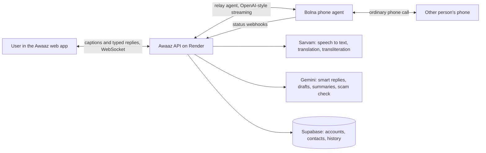

- **The phone leg is Bolna.** We create a Bolna agent whose language model is a custom endpoint on our server (`POST /v1/llm/chat/completions`). Bolna listens to the other person (speech to text) and sends us what they said. Our server decides what to say next: the text the user typed, tapped or approved. Bolna speaks it on the call. Because the reply always comes from the user, nothing is said on their behalf.
- **The relay session** on the API holds the live state of each call: turns, captions, translations, the scam shield, the opening line and the call state. It sends events to the app over a WebSocket (`/v1/relay/{id}`) and takes the user’s actions back. The protocol is documented in [`specs/protocol/`](specs/protocol/relay-events.md) and the tests check every event against its JSON schema.
- **A leg is the other person’s side of a call.** The session talks to an `OtherLeg` interface with three implementations: a scripted fake caller (practice calls and tests), the Bolna phone leg, and the browser callee simulator. All provider code lives in `apps/api/app/providers/`; all relay logic in `apps/api/app/relay/`.
- **Sarvam** handles Indian-language speech and text (streaming speech to text for the mic, translation, converting English letters into a regional script). **Gemini** writes the smart replies, drafts and summaries, and checks suspicious calls.
- **Supabase** stores accounts, profiles, contacts, phrases, call history and summaries (17 tables, row-level security on all of them). Sign-in is Supabase Auth (Google or email).
- **Audio is not stored.** Only the text of the call is kept, and the user can read it in the call log.

### The life of a call

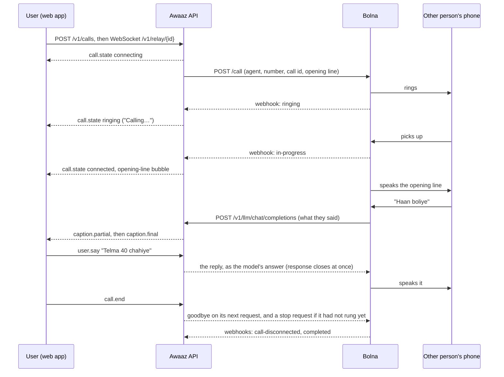

**Call states.** The app sees one `call.state` event per change:

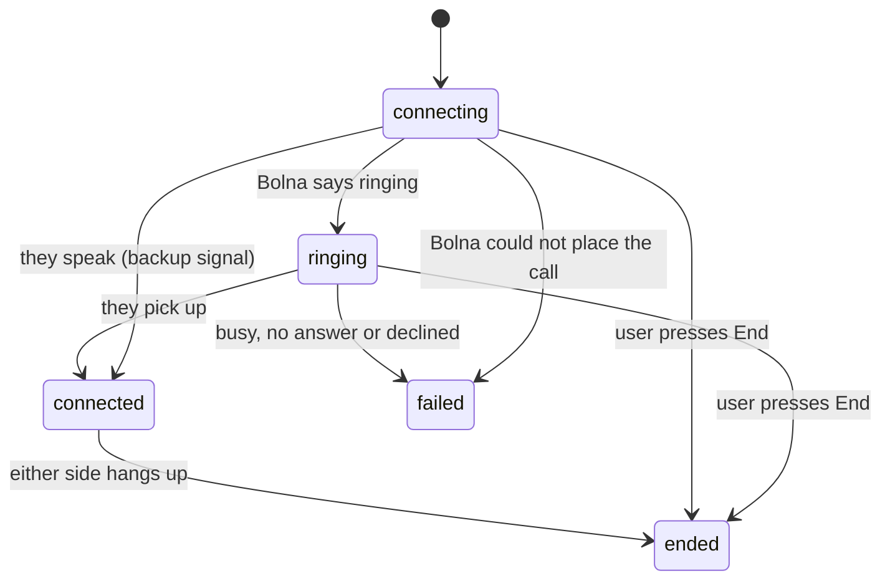

| Bolna status (webhook) | Awaaz state | What the user sees |
|---|---|---|
| `queued`, `initiated` | `connecting` | Connecting… |
| `ringing` | `ringing` | Calling… |
| `in-progress` | `connected` | Connected, timer starts, opening-line bubble |
| `busy` before pickup | `failed`, reason `busy` | The line is busy. |
| `no-answer` before pickup | `failed`, reason `no_answer` | No answer. |
| `call-disconnected` / `canceled` before pickup | `failed`, reason `declined` | They declined the call. |
| `failed`, `error`, `balance-low` before pickup | `failed`, reason `failed` | The call didn’t connect. |
| `call-disconnected`, `completed` after pickup | `ended`, reason `callee_hung_up` | They hung up. |

The status names were confirmed in production logs: a normal call arrives as `initiated`, `ringing`, `in-progress`, `call-disconnected`, `completed`.

### Why one reply per turn

Bolna asks our server what to say only **after the other person speaks**, and it speaks a reply only **once the response is complete** (text streamed into a response that stays open is not spoken until it closes, and is dropped if the other person speaks first; we saw this in Bolna’s own call transcripts). So the relay answers as soon as the user sends something and closes the response, and messages sent within 0.3 s of each other are spoken together. A message sent after that waits until the other person speaks again; the chat shows “queued”. This is a property of the phone line, and it is why a “please hold while I type” line cannot be played mid-typing on a Bolna call.

### Ending a call

Bolna’s stop endpoint only cancels calls that are **queued or scheduled**; for a call in progress it answers `Cannot stop call with status: in-progress`. So when the user presses End:
1. The session ends in the app immediately and the record is saved.
2. A stop request is sent (retried for up to 90 seconds if Bolna refuses because it has not started dialling yet, since Bolna can dial a call it already accepted a few seconds later).
3. If the call is live, the next time Bolna asks what to say, the reply is a goodbye in the call language (“Amit has ended the call. Goodbye.”), repeated up to three times if the other person keeps talking. The call stays reachable for three minutes, or until Bolna reports it over.
4. Bolna can hang up a conversation on its own when it judges it complete. Turn on **“Hangup using a prompt”** for the relay agent in the Bolna dashboard, with a prompt such as:

   > You decide whether a phone conversation is over. It is over only if the assistant’s last message says that the call has ended and says goodbye, for example “Amit has ended the call. Goodbye.” or the same in Hindi (“कॉल समाप्त कर दिया है”) or Marathi (“कॉल संपवला आहे”). Otherwise it is not over.

   Without this setting the other person still hears the goodbye, but the line stays open until they hang up or Bolna’s silence timeout (120 s) ends it. **This end-to-end hang-up has not been verified on a real call yet.**

### Live voice

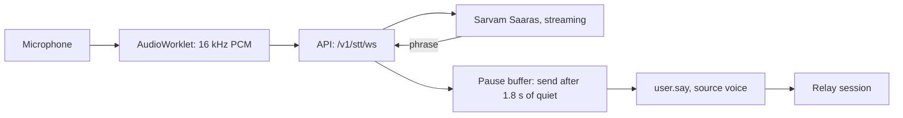

The server keeps one Sarvam stream per recording and reopens it if Sarvam drops it. Speech-start events from Sarvam tell the app the user is still talking, which holds the pause buffer open.

### Preparing what the user types

Typed text goes through the same steps whether it comes from the app or a practice call: detect the language of the text (Gemini), convert English letters or numbers into the call’s script (Sarvam transliteration, numbers in spoken form), translate if it is in a different language (Gemini), and decide whether it needs the user’s confirmation. The app sends a `say.prefetch` while the user pauses mid-typing, so this is usually done before they press send.

### Scam shield

Rules from [`specs/data/scam_keywords.csv`](specs/data/scam_keywords.csv) (scam openers, OTP, PIN, CVV, UPI PIN, remote-access apps) run on every caption, with a Gemini second opinion for borderline lines. A hit sends `scam.warning` to the app, blocks 4–8 digit runs in anything the user sends for the rest of the call (`say.blocked`), and writes a `scam_events` row. The rule set has zero missed requests on the test set in [`specs/data/scam_eval.csv`](specs/data/scam_eval.csv).

### API surface

| Endpoint | Purpose |
|---|---|
| `POST /v1/calls`, `GET /v1/calls?limit=`, `GET /v1/calls/{id}`, `GET /v1/calls/{id}/summary` | Start a call, list history (default 30, up to 200), one call with its turns, the after-call summary |
| `WS /v1/relay/{id}` | The live call: events in both directions. A reconnect replays missed turns, and for a call the server no longer holds it answers `ended` with reason `server_restarted` |
| `WS /v1/stt/ws` | Live voice: PCM in, phrases out |
| `POST /v1/llm/chat/completions`, `GET /v1/llm/models` | The custom model Bolna calls (bearer-protected) |
| `POST /v1/webhooks/bolna` | Bolna call status updates (secret in the URL) |
| `GET /v1/me`, `PUT /v1/me`, `POST /v1/consent` | Profile, settings, consent |
| `/v1/contacts`, `/v1/phrases` | Contacts and saved phrases |
| `POST /v1/text/transliterate`, `POST /v1/text/transcribe` | Script conversion; speech file to text |
| `GET/POST /v1/webhooks/wa/meta`, `POST /v1/webhooks/wa/twilio_sandbox` | WhatsApp (see [Work in progress](#work-in-progress-and-future-scope)) |
| `GET /v1/health` | Health check, used by the keep-alive |

The `/dev/console` page and `/v1/dev/token` exist only when `APP_ENV=local` (404 otherwise); the other `/v1/dev/*` helpers need the webhook secret.

### Data

Postgres on Supabase, created by the migrations in [`supabase/migrations/`](supabase/migrations/). Tables: `profiles`, `comm_profiles`, `contacts`, `phrases`, `consents`, `calls`, `turns`, `summaries`, `scam_events`, plus tables reserved for later work (`voices`, `awaaz_numbers`, `wa_users`, `family_links`, `tasks`, `approvals`, `jobs`, `audit_log`). The API uses the service role; the browser only ever talks to the API, and row-level security stays on for everything.

The live-call protocol is documented in [`specs/protocol/`](specs/protocol/relay-events.md); the design decisions are in [`docs/DECISIONS.md`](docs/DECISIONS.md).

## Rules the product keeps

1. Every call starts with a line telling the other person an assistant is involved. It is not configurable.
2. Nothing is said on a call without a user action, except that opening line and the goodbye when the user ends the call.
3. AI-drafted and translated text is shown to the user and spoken only after they confirm.
4. The scam shield warns on scam openers and on any OTP, PIN, CVV, UPI PIN or remote-app request, never speaks 4–8 digit numbers after that, and logs the event.
5. No caller-ID spoofing. Calls show the Awaaz line’s number.
6. Audio is not stored; limits cap the minutes per call (`MAX_CALL_MINUTES`) and per day (`DAILY_MINUTES_PER_USER`).
7. All demo names, numbers and conversations are fictional.

## Tech stack

| Layer | Choice |
|---|---|
| Web app | React 18, TypeScript, Vite (installable web app), Tailwind CSS v4, shadcn/ui, TanStack Query, React Router, i18next, AudioWorklet for the microphone |
| API | Python 3.12+ (3.14 in production), FastAPI, Pydantic v2, asyncio, httpx, websockets |
| Phone calls | Bolna (custom-LLM relay agent, status webhooks) |
| Speech and Indian languages | Sarvam (Saaras streaming speech-to-text for live voice, translation, transliteration) |
| AI | Gemini (smart replies, drafts, summaries, scam second opinion, language detection) |
| Data and sign-in | Supabase (Postgres with row-level security, Auth) |
| Hosting (all free tiers) | Vercel (web), Render (API), Supabase |
| Tests | pytest (205 API tests), vitest (50 web tests), ruff, TypeScript strict mode |

## Run it yourself

You need: Python 3.12+ with [uv](https://docs.astral.sh/uv/), a recent Node with pnpm, a Supabase project, and keys for Sarvam, Gemini and Bolna.

```bash
# API
cd apps/api
cp ../../env/api.env.example .env      # fill in the keys; set MOCK_PROVIDERS=true to run with no keys
uv sync
uv run uvicorn app.main:app --port 8000

# Web (second terminal)
cd apps/web
cp ../../env/web.env.example .env      # Supabase URL and anon key, API address
pnpm install
pnpm dev                               # http://localhost:5173
```

- **No keys at all:** set `MOCK_PROVIDERS=true`. Practice calls, captions, replies and the scam shield all work with scripted data.
- **Local sign-in shortcut:** with `APP_ENV=local` on the API and `VITE_DEV_LOGIN=true` on the web app, a dev user can sign in without Supabase. Never set it in production.
- **Database:** run the SQL in `supabase/migrations/` in order on your Supabase project, then enable Google and email sign-in.
- **Real phone calls:** create a Bolna account, register the custom model and create the relay agent with `scripts/bolna_spike.py` (see [`docs/DEPLOY.md`](docs/DEPLOY.md)), then add the agent ID and API key to `.env`. On Bolna’s free trial, verify your own phone number first. Turn on prompt-based hangup on the agent (see [Ending a call](#ending-a-call)).

**API settings** (names only; see [`env/api.env.example`](env/api.env.example)):

| Variable | What it does |
|---|---|
| `APP_ENV`, `PUBLIC_BASE_URL`, `WEB_BASE_URL` | Environment, the API’s public address (Bolna calls back to it), the web address |
| `CORS_ORIGINS`, `CORS_ORIGIN_REGEX` | Which web addresses may call the API. **A custom domain must be added to `CORS_ORIGINS`.** |
| `MOCK_PROVIDERS` | `true` runs everything with scripted data and no keys |
| `WEBHOOK_SECRET` | Protects the Bolna webhook and the custom-model endpoint |
| `SUPABASE_URL`, `SUPABASE_SERVICE_ROLE_KEY`, `SUPABASE_JWKS_URL` | Database and token verification |
| `SARVAM_API_KEY` | Speech to text, translation, transliteration |
| `LLM_PROVIDER`, `LLM_MODEL`, `LLM_API_KEY` | Gemini for replies, drafts, summaries, scam check |
| `BOLNA_API_KEY`, `BOLNA_RELAY_AGENT_ID` | Phone calls |
| `MAX_CALL_MINUTES`, `DAILY_MINUTES_PER_USER` | Cost guards (defaults 15 and 60) |
| `WA_PROVIDER`, `META_WA_*` | WhatsApp (not in use, see below) |

**Web settings:** `VITE_API_BASE`, `VITE_WS_BASE`, `VITE_SUPABASE_URL`, `VITE_SUPABASE_ANON_KEY` (see [`env/web.env.example`](env/web.env.example)).

## Testing

```bash
cd apps/api && uv run pytest          # 205 tests
cd apps/web && pnpm test              # 50 tests
cd apps/web && pnpm run typecheck     # strict TypeScript
cd apps/api && uv run ruff check app tests
```

| Area | What the tests cover |
|---|---|
| Relay and protocol | End-to-end scripted calls over the WebSocket, every event validated against the JSON schema, reconnect and replay, a call the server lost |
| Bolna leg | Fragmented speech, replies that close the response, batching and ordering, call states from status webhooks, busy / no answer / declined, stop retries, goodbye on End, registry lifetime |
| Safety | Scam shield on the eval set, digit blocking, disclosure and keeper lines, cost guards |
| Language | Typed-text preparation, translation, caption switching, 12 locale files with identical keys |
| Data | Supabase store against a mocked REST API, startup clean-up of calls left in progress, call history paging |
| Web | Event reducer, dashboard stats, duration formatting, the voice pause buffer, profile saving, sign-in logic |

New behaviour in this project was written test-first. The UI is checked with real browser screenshots at phone and desktop sizes.

## Deployment and operations

| Part | Where |
|---|---|
| Web | Vercel, built from `main` (root directory `apps/web`), served at https://awaazai.amitpile.com |
| API | Render free web service in Singapore (`awaaz-api`), auto-deploys from `main`, Python 3.14 |
| Database and sign-in | Supabase (ap-south-1) |
| Keep-alive | A Supabase `pg_cron` job pings `/v1/health` every 10 minutes so the free server does not sleep |

Details, environment values and the Google sign-in redirect fix are in [`docs/DEPLOY.md`](docs/DEPLOY.md). Things worth knowing:

- **Sessions live in memory** (one API instance, no Redis). A deploy or restart ends calls in progress. On start-up the API marks any call still “in progress” as ended, and an app that reconnects to a lost call is told it ended (reason “service update”) and stops retrying.
- **Using your own domain** needs three changes: add it to `CORS_ORIGINS` on Render, to the Supabase **Site URL** and **Redirect URLs**, and to the Vercel project’s domains.
- **Logs.** The API’s own events (Bolna status updates, stop attempts, start-up clean-up) are written at INFO level to the server output. Sign-in tokens and the webhook secret are redacted from access logs, and phone numbers are masked.
- **Debugging a call.** Compare three records for the same time: the Render logs, the `calls` and `turns` rows, and Bolna’s own execution record (transcript, latency data, hangup reason) from `GET /executions/{id}`.
- **Cost guards.** One live call per user, `MAX_CALL_MINUTES` per call, `DAILY_MINUTES_PER_USER` per day.

## Project layout and docs

```
apps/
  api/            FastAPI server: relay session, Bolna leg, scam shield, summaries, settings API
  web/            React app: onboarding, dashboard, call chat, call log, contacts, i18n (12 languages)
supabase/         database migrations
specs/            relay protocol, JSON schemas, prompts, data, fixtures, WhatsApp message templates
scripts/          Bolna setup, call analysis, translation generator
design/           original clickable UI prototype and screen map
tasks/            original build plan and checklist
env/              example environment files
CLAUDE.md         working rules for the coding assistant used on this project
docs/             decisions, design, deploy notes, architecture for incoming calls, screenshots
```

| Document | What it covers |
|---|---|
| [`docs/DESIGN.md`](docs/DESIGN.md) | Interface design and the language system |
| [`docs/DECISIONS.md`](docs/DECISIONS.md) | Why each choice was made, including what was dropped and why |
| [`docs/DEPLOY.md`](docs/DEPLOY.md) | Hosting, environment values, redeploying, custom domain |
| [`docs/SPIKE-bolna.md`](docs/SPIKE-bolna.md) | Findings from real Bolna test calls |
| [`docs/ARCHITECTURE-incoming.md`](docs/ARCHITECTURE-incoming.md) | Design for receiving calls (not built) |
| [`specs/protocol/relay-events.md`](specs/protocol/relay-events.md) | The live-call events between the app and the API |
| [`specs/messages/whatsapp_templates.md`](specs/messages/whatsapp_templates.md) | WhatsApp message templates |
| [`docs/PRD.md`](docs/PRD.md), [`docs/PRD-ADDENDUM-v2.md`](docs/PRD-ADDENDUM-v2.md) | Original product requirements |
| [`PROGRESS.md`](PROGRESS.md) | What is done, in progress and unverified |

## Known limits

- **Real calls need a verified number** on Bolna’s free trial (see above). Practice calls have no such limit.
- **Bolna can be slow to start dialling.** Usually the phone rings 1–5 seconds after Call; once it took about 30 seconds. The screen says *Connecting…* the whole time and End is available.
- **One reply per turn.** Bolna asks what to say only when the other person speaks, so messages sent a few seconds apart wait for them (the chat says “queued”). Voice phrases are merged into one message to avoid this. See [Why one reply per turn](#why-one-reply-per-turn).
- **No “please hold” while typing.** The other person hears silence while the user types; keep replies short, or use phrases. On a real call one callee hung up after about 70 seconds of silence.
- **Hanging up a live call depends on a Bolna dashboard setting** (prompt-based hangup), because Bolna has no API to end a call in progress, and it has not been verified on a real call. If the other person is silent and Bolna is not waiting on us, the goodbye cannot be said until they speak.
- **Numbers heard over a real phone line are not always captured correctly.** In our test calls, speech recognition caught about 5 of 12 spoken numbers. Awaaz highlights numbers and the user can use “Ask again”, but the user should confirm important numbers.
- **Live voice waits about 2 seconds after the user stops speaking** before sending, so that natural pauses do not split a sentence. The wait is one constant in the code (`VOICE_GAP_MS`).
- **The free server sleeps and restarts.** A keep-alive ping keeps it mostly awake, but the first request after a long gap can take up to a minute. A deploy ends any call in progress.
- **Dashboard numbers are approximate.** “Picked up” means the call ended normally; a call the user cancelled while it was ringing before Awaaz tracked call states can count as picked up. Stats use the 200 most recent calls.
- **Translations of the app are machine-made** and have not been reviewed by native speakers.
- **Vibration cues** work on Android and desktop Chrome, not on iPhones. The read-aloud voice depends on the voices installed on the phone.
- **Caption translation can drift on names and medicines.** The original text is always shown beneath it.

## Work in progress and future scope

### Work in progress: WhatsApp

Idea: the whole call runs inside a WhatsApp chat with the Awaaz number, for people who live in WhatsApp and will not install anything.

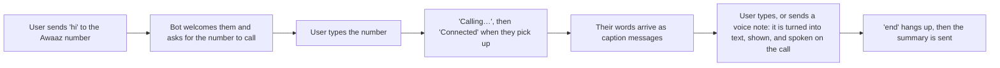

**What is built** (and tested against a log provider, without WhatsApp):
- An adapter for Meta’s **WhatsApp Cloud API**: sending text, the webhook handshake, signature checking, and reading text, voice-note and button messages. Webhook: `GET/POST /v1/webhooks/wa/meta`. A Twilio sandbox adapter exists too, but Twilio’s free number cannot push messages.
- A chat bot that reuses the same relay as the app. `call 98765 43210` or `call practice pharmacy` starts a call; each thing the other person says arrives as a message (numbers in bold); anything typed is spoken, with the same confirm rules; `again`, `hold` and `end` work; `ok` or `cancel` answers a translation preview. A WhatsApp number gets a lightweight account on first contact.
- Message templates for use outside WhatsApp’s 24-hour window are written in [`specs/messages/whatsapp_templates.md`](specs/messages/whatsapp_templates.md) (not submitted).

**What blocks it.** Meta’s free test number could not send messages: the test WhatsApp Business Account came back **locked (error 131031, “Business Account locked”)** and asked for business verification, which a personal developer account does not have. Outbound messages, including the bot’s own replies, are blocked until that is resolved. Options: a fresh Meta app under a different business, a support request to Meta, or verifying a small business.

**What is still missing, so the flow above is not complete:**
- A welcome message on “hi”, and a bare phone number starting a call (today it needs the word “call”).
- Call progress messages for *connecting*, *ringing* and *connected* (the bot reports only the end of a call); the call-state work in the app is the model for this.
- **Voice notes**: download the audio from Meta, transcribe it with Sarvam, show “I heard: …”, and speak it after the user confirms. The bot currently replies “voice notes are coming soon”.
- **Account linking** with the web app account (profile, contacts, language, call log) through a one-time code, or a decision to keep WhatsApp-only accounts.
- Delivery-status handling (failed, expired 24-hour window, expired access token) instead of failing silently, and quick-reply buttons.
- Using a long-lived system-user access token. The temporary test token expires in about a day.

**Setting it up once Meta allows sending:** set `WA_PROVIDER=meta_cloud`, `META_WA_TOKEN`, `META_WA_PHONE_ID`, `META_WA_APP_SECRET` and `META_WA_VERIFY_TOKEN` on the API; in the Meta dashboard under WhatsApp, Configuration, set the webhook to `https://<api>/v1/webhooks/wa/meta` with the same verify token and subscribe to the `messages` field; add each tester’s number under API Setup (the test number allows up to 5 recipients).

**What WhatsApp cannot do here:**
- Play the user’s own voice into the call. Voice notes are converted to text first, and Awaaz speaks that text.
- Show captions word by word. Sent WhatsApp messages cannot be edited, so captions arrive one message per sentence.
- Message someone first outside the 24-hour window without an approved template.

### Receiving calls (design exists, not built)

The design for incoming calls is written up in [`docs/ARCHITECTURE-incoming.md`](docs/ARCHITECTURE-incoming.md), with three paths:
- **An Awaaz number for each user.** Someone dials it, an Awaaz agent answers with the user watching in the app, the user’s typed replies are spoken, and if the user does not answer the caller can leave a message that is captioned and kept. Needs a number bought through Bolna.
- **Forwarding from the user’s own SIM number**, so callers dial the number they already know, with a screen that shows the right forwarding code for each carrier.
- **Joining a normal call (“merge”)** as a third participant, first with a manual guide and later with an Android app that merges automatically.
- **Alerts built for people who can’t hear a ring**: web push, WhatsApp, flashing and vibration.

### More helpful features
- **Tap-to-save phone numbers** picked out of captions.
- **Calendar reminders** from the summary (a time agreed on a call becomes a reminder).
- **Call for me**: Awaaz makes a simple task call (booking a cylinder, confirming an appointment) by itself, with approval for anything outside set limits, and reports back.
- **Clearer speech recognition for numbers**: confidence marks, “did you mean” chips, and automatic read-back.
- **A way to speak while the user types.** Bolna cannot play a “please hold” line mid-typing; a phone line we control end to end would allow it, and would also make hanging up a live call a single request. See the decision notes.
- **The user’s own voice on the call.** Live voice speaks with Awaaz’s voice today. Carrying the user’s real voice needs that same kind of line, or a consented voice clone.
- **Callee simulator** for testing speech features without a phone.
- **Family helper**: a relative can set up the profile and see (with consent) the call summaries.
- **Accessible helpline for businesses** such as pharmacies, banks and clinics.
- **A native Android app** for full-screen incoming-call alerts and automatic merging.
- **Native-speaker review** of the 11 machine-translated languages.

### Not possible with the current phone line, and left out on purpose
- **Live audio of the other person into the app.** The phone line returns text, not audio.
- **Passing the user’s raw voice audio into the call through Bolna.** Bolna’s agent speaks text we give it and has no audio input for us, so speech is converted to text first (this is what Live voice does).
- **Ending a live call with one API request.** Bolna’s stop only cancels calls that have not started.
- **Sign language interpreter by video.** This needs a partner service.

## Credits and licence

Built by Amit Pile for the Bolna Buildathon. All names, phone numbers and conversations in the demos are fictional.

Released under the [MIT License](LICENSE). Third-party services (Bolna, Sarvam, Gemini, Supabase) have their own terms; the machine-generated translations should be reviewed before use in production.
