# Awaaz

**Ordinary phone calls for people who can’t hear or speak.**

Awaaz lets someone who is deaf, hard of hearing, or unable to speak make a normal phone call. They type (or speak into the mic, or tap a phrase) and Awaaz says it aloud on the call. What the other person says appears on screen as live captions, in the language the user reads. The person on the other end just hears an ordinary call, with a short opening line telling them an assistant is helping.

Built for the **Bolna Buildathon** (deadline 31 October 2026, noon IST).

| | |
|---|---|
| **Live demo** | https://awaaz-web-sigma.vercel.app |
| **Try it first** | Sign in, then use **Practice calls** on the home screen. They need no phone number and work for everyone. |
| **Real phone calls** | Work only for numbers verified in Bolna. See [Try a real call](#try-a-real-call-verified-numbers-only). |

<p>
  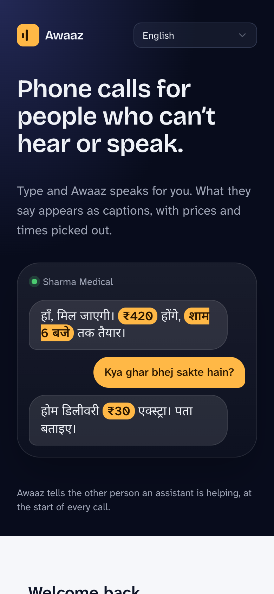
  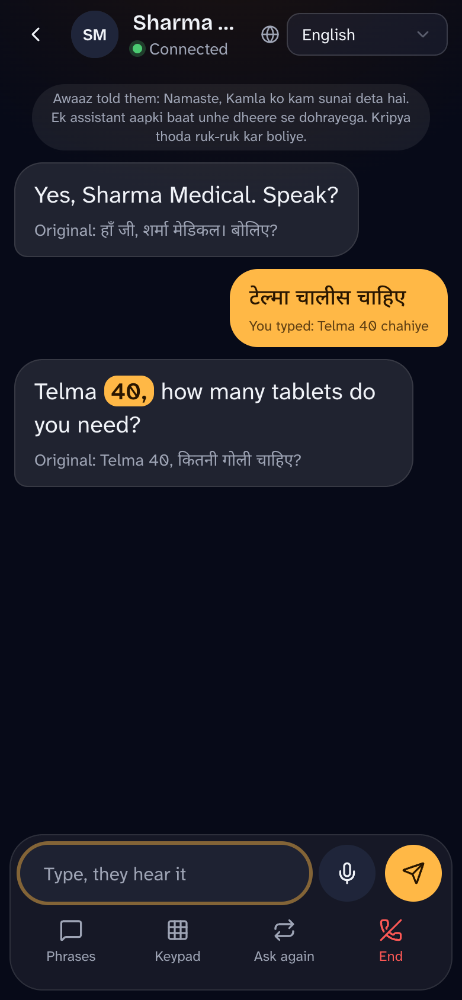
  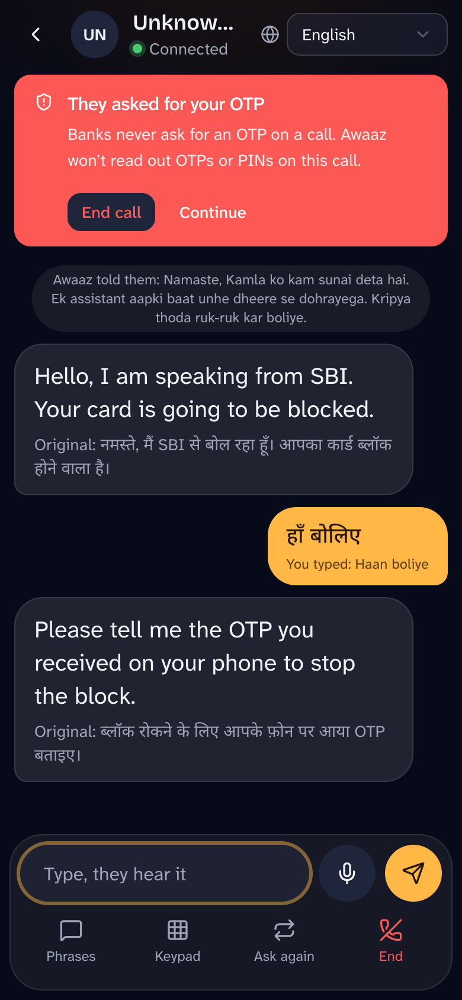
  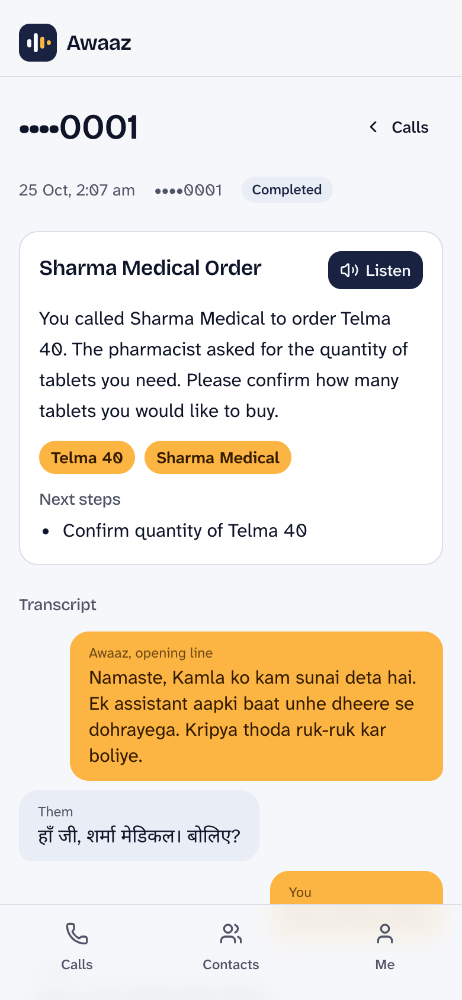
</p>

---

## Contents
1. [The problem](#the-problem)
2. [What Awaaz does](#what-awaaz-does)
3. [Screens](#screens)
4. [Features](#features)
5. [Try it](#try-it)
6. [How it works](#how-it-works)
7. [Rules the product keeps](#rules-the-product-keeps)
8. [Tech stack](#tech-stack)
9. [Run it yourself](#run-it-yourself)
10. [Project layout and docs](#project-layout-and-docs)
11. [Known limits](#known-limits)
12. [Future scope](#future-scope)

---

## The problem

The phone call is still how everyday business gets done in India: the pharmacy that confirms a medicine, the bank that verifies a payment, the clinic that gives an appointment time, the gas agency that books a cylinder. Most of these places do not use chat, email or video.

For someone who can’t hear or can’t speak, a phone call is closed off:
- They cannot follow what is said, or cannot answer.
- They depend on a family member or neighbour to call for them, which costs privacy and independence. A medical or banking call is the worst one to hand to someone else.
- They are easy targets for phone scams. The scammer’s urgency and tone go unheard, and an OTP read out loud is gone.

Millions of people in India live with a hearing or speech disability. Census 2011 counted roughly 5 million with a hearing disability and 2 million with a speech disability, and WHO-based estimates of significant hearing loss are much higher. These are approximate figures from memory and should be checked against the sources before quoting them. Text relay services exist in some countries, but to our knowledge there is no widely available, free, Indian-language equivalent that works with an ordinary phone number at the other end.

**The cause is simple: the other end of the line has not changed, and it won’t.** The pharmacy is not going to install an app. So the fix has to live entirely on the caller’s side, and the call has to look normal to everyone else.

## What Awaaz does

Awaaz sits between the user and the person they are calling:

1. The user opens Awaaz and starts a call.
2. Awaaz rings the other number through a phone line and says a short opening line: *an assistant is helping this person, please speak slowly.*
3. Everything the other person says is turned into **live captions**, in the user’s chosen language, with prices, times and numbers highlighted.
4. The user answers by **typing**, **speaking into the mic**, tapping a **saved phrase** or a **smart reply**, or using **Help me say it** (a few words become a clear sentence the user approves first). Awaaz speaks it on the call.
5. After the call, the user gets a **summary**: what was agreed and the numbers to remember.

It is not a chatbot and it does not talk for the user. Nothing is said on the call unless the user does something.

## Screens

| Language first | Pick how you talk | Choose your options |
|---|---|---|
| 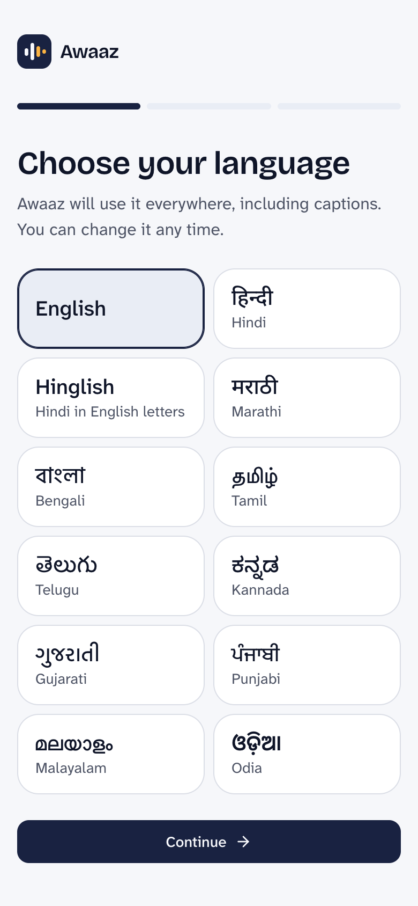 | 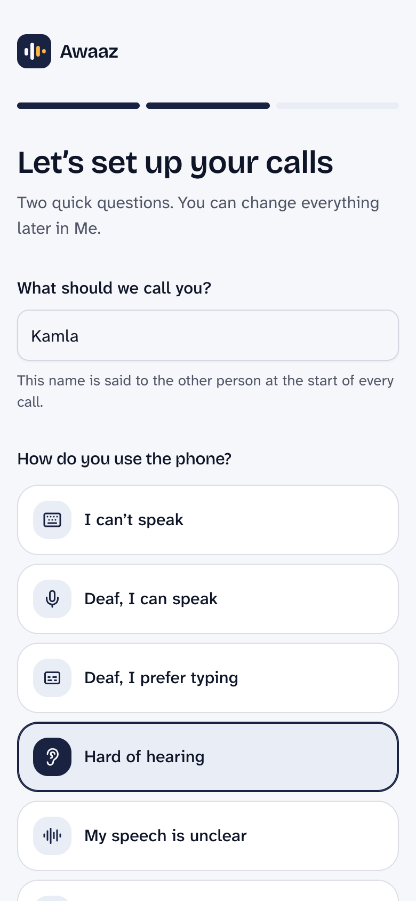 | 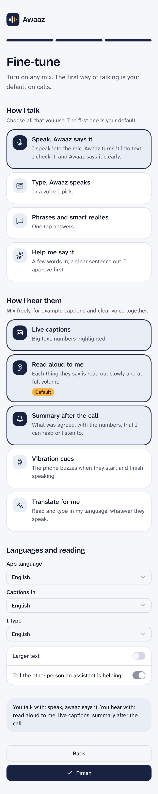 |

| Calls home | Live call | Scam warning |
|---|---|---|
| 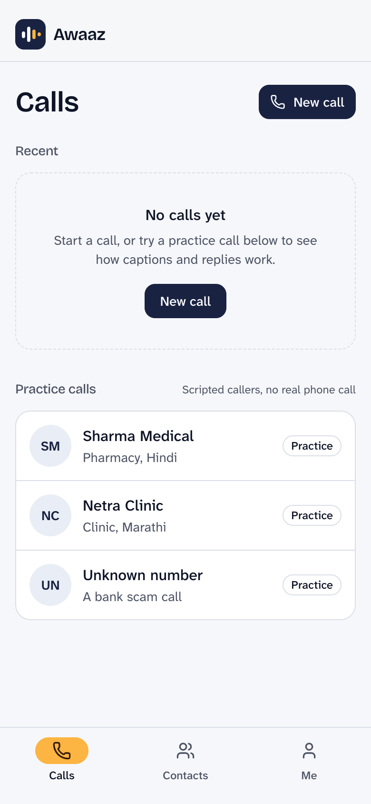 |  |  |

| After the call | Contacts | Settings |
|---|---|---|
|  | 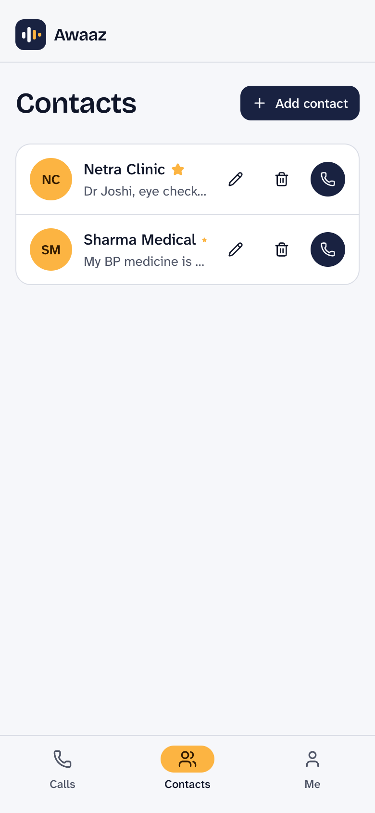 | 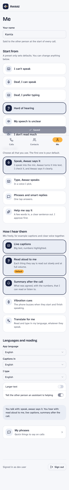 |

The app is also available in Tamil (below) and ten other languages.

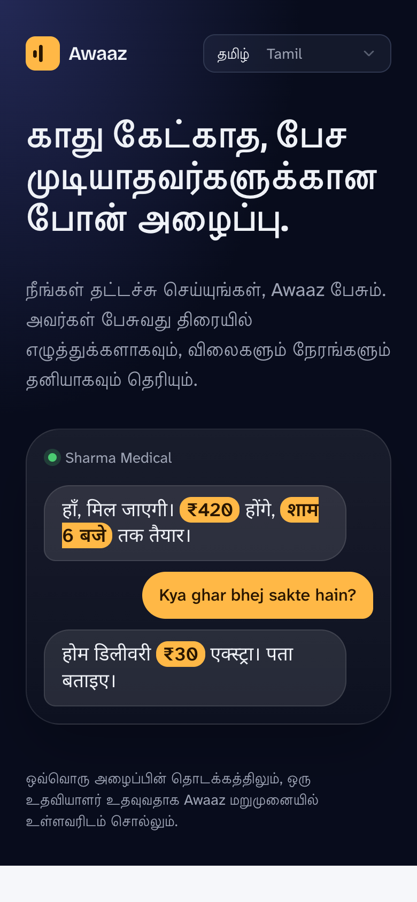

## Features

**Making a call**
- Outbound calls through a real phone line (Bolna), with a spoken opening line on every call.
- **Practice calls**: scripted callers (a Hindi pharmacy, a Marathi clinic, a bank-scam caller) that need no phone. Smart replies, translation and drafts run live in them.
- Keypad for phone menus (“press 1 for…”), “Ask again” to ask the other person to repeat, a confirm step before ending a call.
- A “please hold” line while the user is typing, so the other person is not left in silence.
- Daily and per-call minute limits.

**Talking: choose any mix**
- **Type, and Awaaz speaks.** Typing in Hindi, Marathi or English works; text in the call’s own script is spoken straight away.
- **Phrases and smart replies.** Saved phrases, plus one-tap suggested answers after the other person speaks.
- **Help me say it.** A few words in, a clear sentence out. The user approves it before it is spoken.
- **Speak, Awaaz says it.** Speak into the mic; speech becomes text in the message box, the user checks it, and Awaaz says it clearly.
- Typing in any Indian script with the phone’s own keyboard. If the user types in English letters, Awaaz offers the same text in their own script.
- Text typed in a different language than the call’s is translated, shown, and spoken only after the user confirms.

**Hearing: choose any mix**
- **Live captions** with big text, and prices, times and numbers highlighted.
- **Translate for me.** Captions appear in the call’s language first, then the user’s language follows underneath, with the original always kept in view.
- **Switch the caption language during the call.** The last few captions are translated again.
- **Read aloud.** Each thing the other person says is read out slowly in their exact words.
- **Vibration cues** when the other person starts and stops speaking (Android and desktop Chrome).
- **Summary after the call**: what was agreed, key numbers, next steps, and a Listen button.

**Safety**
- **Scam shield.** When someone asks for an OTP, PIN, UPI PIN, CVV or to install a remote-access app, Awaaz shows a red warning, refuses to speak any 4–8 digit number on that call, and logs the event.
- An opening line on every call says an assistant is helping. This cannot be turned off.
- AI-drafted and translated text is shown first and spoken only after the user confirms.

**Languages**
- The whole app in **12 languages**: English, Hindi, Hinglish (Hindi in English letters), Marathi, Bengali, Tamil, Telugu, Kannada, Gujarati, Punjabi, Malayalam and Odia.
- Language is the first onboarding question and can be changed any time, including on the login screen.
- The language the other person speaks is set per contact or when starting a call.
- The 11 non-English translations are machine-made and still need a native-speaker review.

**Account and settings**
- Sign in with Google or with email and password.
- Six starting profiles (for example “Deaf, I prefer typing”, “Hard of hearing”, “I can’t speak”), then fine-tune each option.
- Contacts with favourites and notes that smart replies can use (“my BP medicine is Telma 40”).
- Call history with transcripts, installable as a web app, light and dark themes, larger-text option.

## Try it

### Practice calls (everyone, no phone needed)
1. Open **https://awaaz-web-sigma.vercel.app**. The first load can take up to a minute, because the free server sleeps when idle.
2. Sign in with Google, or create an account with email and password.
3. Choose your language, enter your name, and pick a starting profile.
4. On the home screen, scroll to **Practice calls** and tap one:
   - **Sharma Medical** (Hindi pharmacy): type “Telma 40 chahiye”, then try the caption-language switcher in the header.
   - **Netra Clinic** (Marathi clinic).
   - **Unknown number** (bank scam): reply once and watch the scam shield appear when they ask for an OTP.
5. End the call, then open it from **Recent** to see the transcript and summary.

### Try a real call (verified numbers only)

Real calls go through Bolna’s free-trial phone line, and **Bolna’s trial only dials phone numbers that have been verified on the account**. A number that is not verified will not ring. This is a Bolna trial limit, not an Awaaz one.

**To place a real call to your own phone:**
1. **Send your phone number** (with country code, e.g. `+91XXXXXXXXXX`) to the project maintainer and ask to have it added as a verified number. *(Maintainer: add your contact details here.)*
2. The maintainer adds it in the Bolna dashboard under **Settings → Verified Phone Numbers**; Bolna sends a one-time code to that number to confirm it. Read the code to the maintainer, or enter it yourself if you have dashboard access.
3. Once it shows as verified, open Awaaz, tap **New call**, enter the same number, choose the language the other person speaks, and tap **Call**.
4. Answer your phone. You will hear the opening line from Awaaz’s assistant. Speak, and watch your words appear as captions in the app. Type a reply and hear it spoken on the phone.

**To run real calls to any number:** use your own Bolna account (see [Run it yourself](#run-it-yourself)). Bolna’s paid plan removes the verified-number limit.

## How it works

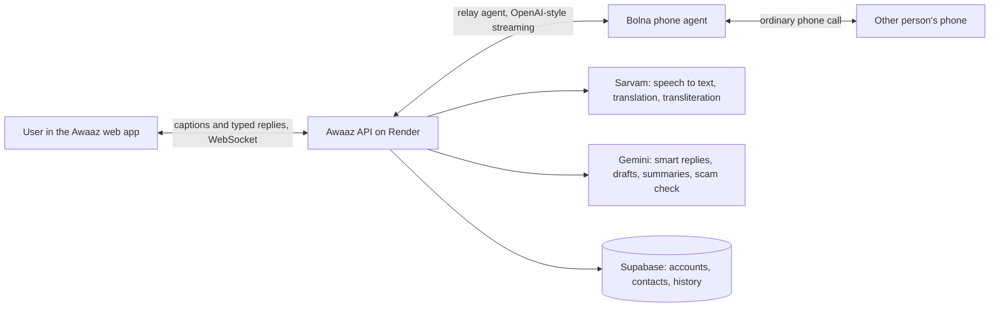

- **The phone leg is Bolna.** We create a Bolna agent whose language model is a custom endpoint on our server. Bolna listens to the other person (speech to text) and sends us what they said. Our server decides what to say next: the text the user typed, tapped or approved. Bolna speaks it on the call. Because the reply always comes from the user, nothing is said on their behalf.
- **The relay session** on the API holds the live state of each call: turns, captions, translations, the scam shield, the keeper line (“please hold”), the opening line. It sends events to the app over a WebSocket and takes the user’s actions back.
- **Sarvam** handles Indian-language speech and text (speech to text for the mic, translation, converting English letters into a regional script). **Gemini** writes the smart replies, drafts and summaries, and checks suspicious calls.
- **Supabase** stores accounts, profiles, contacts, phrases, call history and summaries. Sign-in is Supabase Auth (Google or email).
- **Audio is not stored.** Only the text of the call is kept, and the user can read it in history.

The live-call protocol is documented in [`specs/protocol/`](specs/protocol/relay-events.md); the design decisions are in [`docs/DECISIONS.md`](docs/DECISIONS.md).

## Rules the product keeps

1. Every call starts with a line telling the other person an assistant is involved. It is not configurable.
2. Nothing is said on a call without a user action, except that opening line and the “please hold” line.
3. AI-drafted and translated text is shown to the user and spoken only after they confirm.
4. The scam shield never speaks 4–8 digit numbers after an OTP, PIN, CVV or UPI PIN request, warns the user, and logs the event.
5. No caller-ID spoofing. Calls show the Awaaz line’s number.
6. Audio is not stored; limits cap the minutes per call and per day.
7. All demo names, numbers and conversations are fictional.

## Tech stack

| Layer | Choice |
|---|---|
| Web app | React 18, TypeScript, Vite (installable web app), Tailwind CSS v4, shadcn/ui, TanStack Query, i18next |
| API | Python 3.12+ (3.14 in production), FastAPI, Pydantic v2, asyncio, httpx |
| Phone calls | Bolna (custom-LLM relay agent) |
| Speech and Indian languages | Sarvam (Saaras speech-to-text, translation, transliteration) |
| AI | Gemini (smart replies, drafts, summaries, scam second opinion) |
| Data and sign-in | Supabase (Postgres with row-level security, Auth) |
| Hosting (all free tiers) | Vercel (web), Render (API), Supabase |
| Tests | pytest (150 API tests), vitest (29 web tests), ruff |

## Run it yourself

You need: Python 3.12+ with [uv](https://docs.astral.sh/uv/), a recent Node with pnpm, a Supabase project, and keys for Sarvam, Gemini and Bolna.

```bash
# API
cd apps/api
cp ../../env/api.env.example .env      # fill in the keys; set MOCK_PROVIDERS=true to run with no keys
uv sync
uv run uvicorn app.main:app --port 8000

# Web (second terminal)
cd apps/web
cp ../../env/web.env.example .env      # Supabase URL and anon key, API address
pnpm install
pnpm dev                               # http://localhost:5173
```

- **No keys at all:** set `MOCK_PROVIDERS=true`. Practice calls, captions, replies and the scam shield all work with scripted data.
- **Database:** run the SQL in `supabase/migrations/` in order on your Supabase project, then enable Google and email sign-in.
- **Real phone calls:** create a Bolna account, register the custom model and create the relay agent with `scripts/bolna_spike.py` (see [`docs/DEPLOY.md`](docs/DEPLOY.md)), then add the agent ID and API key to `.env`. On Bolna’s free trial, verify your own phone number first.
- **Tests:** `cd apps/api && uv run pytest` and `cd apps/web && pnpm test`.
- **Deploying:** [`docs/DEPLOY.md`](docs/DEPLOY.md) covers Render, Vercel and Supabase, including the keep-alive that stops the free server from sleeping.

## Project layout and docs

```
apps/
  api/            FastAPI server: relay session, Bolna leg, scam shield, summaries, settings API
  web/            React app: onboarding, calls, captions, contacts, i18n (12 languages)
supabase/         database migrations
specs/            relay protocol, JSON schemas, prompts, data, fixtures
scripts/          Bolna setup, call analysis, translation generator
design/           original clickable UI prototype and screen map
tasks/            original build plan and checklist
env/              example environment files
CLAUDE.md         working rules for the coding assistant used on this project
docs/             decisions, design, deploy notes, architecture for incoming calls, screenshots
```

| Document | What it covers |
|---|---|
| [`docs/DESIGN.md`](docs/DESIGN.md) | Interface design and the language system |
| [`docs/DECISIONS.md`](docs/DECISIONS.md) | Why each choice was made, including what was dropped and why |
| [`docs/DEPLOY.md`](docs/DEPLOY.md) | Hosting, environment values, redeploying |
| [`docs/SPIKE-bolna.md`](docs/SPIKE-bolna.md) | Findings from real Bolna test calls |
| [`docs/ARCHITECTURE-incoming.md`](docs/ARCHITECTURE-incoming.md) | Design for receiving calls (not built) |
| [`docs/PRD.md`](docs/PRD.md), [`docs/PRD-ADDENDUM-v2.md`](docs/PRD-ADDENDUM-v2.md) | Original product requirements |
| [`PROGRESS.md`](PROGRESS.md) | What is done, in progress and unverified |

## Known limits

- **Real calls need a verified number** on Bolna’s free trial (see above). Practice calls have no such limit.
- **Numbers heard over a real phone line are not always captured correctly.** In our test calls, speech recognition caught about 5 of 12 spoken numbers. Awaaz highlights numbers and the user can use “Ask again”, but the user should confirm important numbers.
- **The free server sleeps.** A keep-alive ping keeps it mostly awake, but the first request after a long gap can take up to a minute. Redeploying the server ends any call in progress.
- **Translations of the app are machine-made** and have not been reviewed by native speakers.
- **Vibration cues** work on Android and desktop Chrome, not on iPhones. The read-aloud voice depends on the voices installed on the phone.
- **Caption translation can drift on names and medicines.** The original text is always shown beneath it.

## Future scope

These are designed or planned but **not built or not testable yet**.

**Receiving calls**
- **Incoming calls.** A number that people can dial, answered by Awaaz, with the user watching and replying in the app and an alert for the user. The design is in [`docs/ARCHITECTURE-incoming.md`](docs/ARCHITECTURE-incoming.md); it needs a number bought through Bolna.
- **Missed-call forwarding** from the user’s own SIM number to the Awaaz number, so callers dial the number they already know, with a screen that shows the right forwarding code for each carrier.
- **Message taking** when the user does not answer: the caller’s message is captioned and saved.
- **Joining a normal call (“merge”)** as a third participant, starting with a manual guide and later an Android app that merges automatically.
- **Alerts built for people who can’t hear a ring**: web push, WhatsApp, flashing and vibration.

**WhatsApp**
- **WhatsApp relay.** Send a message to start a call, and the whole call runs as a WhatsApp chat with voice notes. The adapter is built for Meta’s WhatsApp Cloud API; it is waiting on a working Meta test number (Meta’s test-number service was failing when we tried).

**More helpful features**
- **Tap-to-save phone numbers** picked out of captions.
- **Calendar reminders** from the summary (a time agreed on a call becomes a reminder).
- **Call for me**: Awaaz makes a simple task call (booking a cylinder, confirming an appointment) by itself, with approval for anything outside set limits, and reports back.
- **Clearer speech recognition for numbers**: confidence marks, “did you mean” chips, and automatic read-back.
- **Your own voice**: speaking in the user’s own voice, with consent, where they want it.
- **Callee simulator** for testing speech features without a phone.
- **Family helper**: a relative can set up the profile and see (with consent) the call summaries.
- **Accessible helpline for businesses** such as pharmacies, banks and clinics.
- **A native Android app** for full-screen incoming-call alerts and automatic merging.
- **Native-speaker review** of the 11 machine-translated languages.

**Not possible with the current phone line, and left out on purpose**
- **Live audio of the other person into the app.** The phone line returns text, not audio.
- **Passing the user’s own voice straight through.** The phone line speaks text we give it, so speech is converted to text first.
- **Sign language interpreter by video.** This needs a partner service.

## Credits and licence

Built by Amit for the Bolna Buildathon. All names, phone numbers and conversations in the demos are fictional. No licence has been chosen yet; until one is added, all rights are reserved.
