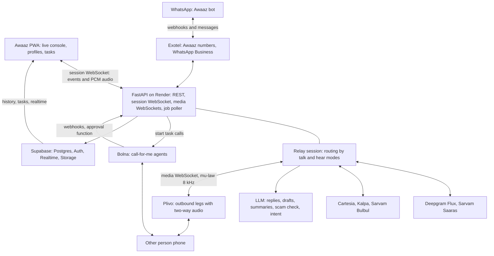

# Awaaz — Technical Implementation Guide

Version 1.0, 23 October 2026. Written for the Bolna Buildathon build (submission due 31 October 2026) and for handover to Claude Code.

This guide is the source of truth for **how to build** Awaaz. `docs/PRD.md` (product v0.1) and `docs/PRD-ADDENDUM-v2.md` (talk-and-hear profiles, call paths, WhatsApp, own number) say **what to build and why**. Where the PRD's technical sections disagree with this guide, this guide wins. The visual source of truth is `design/ui-prototype.html` (v2).

Lines marked **⚠️ VERIFY** describe third-party API details that were not confirmed against live documentation. Check each one before coding against it, and keep every provider behind an adapter so a wrong guess is a one-file fix.

---

## 1. What we are building

Awaaz makes phone calls possible for people who can’t hear or speak. A person chooses **how they talk** (type, own voice, phrases, “help me say it”) and **how they hear** (captions, clear voice, normal audio, summaries, vibration, translation), and Awaaz sits on the call to translate between those choices and an ordinary phone call.

Four ways in:

1. **Live call on the Awaaz line.** The call runs on Awaaz’s server; the app is the live console.
2. **Clear voice.** For people who speak but can’t hear well: each sentence from the other person is repeated slowly and loudly to the user only.
3. **Call for me.** A Bolna agent makes the whole call, asks the user to approve anything outside their limits, and reports back.
4. **WhatsApp bot.** Start calls and tasks, read live captions as messages, transcribe voice notes, and send voice notes in your own voice, with no app install.

### Scope for 31 October

| Area | P0 (submission) | P1 (if time) | P2 (roadmap, document only) |
|---|---|---|---|
| Live call, type to speak | Outbound to any Indian number, captions, chips, smart replies, phrases, keeper, ask again, keypad, end | — | — |
| Talk modes | Type, phrases/smart replies, Help me say, My own voice (in-app audio) | Speak clearly for me | Sign language interpreter handoff |
| Hear modes | Captions, normal audio (in-app), translate, spoken summary | Clear voice to app audio, vibration cues | Clear voice on a phone leg, watch haptics |
| Clear voice | Re-speak to the app user (in-app audio) | User on a phone leg (second Plivo call) | — |
| Profiles | Presets + talk/hear selections + languages + voice; per-contact override stored | Live switching of hear modes mid-call | — |
| Call for me | Gas and medicine templates on Bolna, approval in app and WhatsApp, result card | Doctor appointment template | — |
| WhatsApp bot | Tasks by message, call summaries, voice note → text, text → voice note | Live relay in chat | WhatsApp calling (Business Calling API) |
| Scam shield | OTP/PIN request detection, warning, digit blocking | — | — |
| Own voice | Stock voices | Voice cloning from samples with consent | — |
| Incoming calls | — | Personal Awaaz number rings the app; message taking | Android merge into SIM calls (native app) |
| Face to face | — | PWA split screen using the same STT/TTS | — |

### Guiding decisions

- **One relay core, many inputs.** Everything that talks on a call (typed text, phrases, AI drafts, the user’s own audio) and everything that comes back (captions, clear voice, summaries) goes through one server-side relay session. Modes are just routing choices on that session.
- **Mock first.** `MOCK_PROVIDERS=true` runs the whole app with a scripted fake callee and no API keys. A browser “callee simulator” page provides real two-way audio without any telephony.
- **The user’s words are the user’s.** Nothing is spoken on a call without the user’s tap, except the disclosure line, the keeper line and the user’s own live voice.
- **No caller-ID spoofing.** Calls show the Awaaz number. Keeping the user’s own number requires the merge path (P2), never CLI manipulation.

---

## 2. Final tech stack

| Layer | Choice | Why |
|---|---|---|
| App | React 18 + TypeScript + Vite, installable PWA | Works on cheap Android phones; no store review in 8 days |
| App hosting | Vercel | Instant deploys; `/api` rewrite |
| Live channel | One WebSocket per call session between app and API | Captions, actions and in-app audio on one connection |
| In-app audio | `getUserMedia` + AudioWorklet, 16 kHz PCM over the session WebSocket; playback via AudioWorklet ring buffer | Simpler than WebRTC for the hackathon; works with Bluetooth hearing aids and headphones |
| Backend | Python 3.12, FastAPI, Pydantic v2, asyncio, httpx, `websockets` | Long-lived WebSockets, audio glue, JSON schemas |
| Backend hosting | Render **Starter** (paid) for the relay | Long WebSockets; free instances sleep and restart |
| Database, auth, realtime, storage | Supabase | Same as Bhasha OPD |
| Telephony, live legs | Plivo outbound calls with bidirectional audio streams | Full control of the other party’s audio |
| Telephony, numbers and WhatsApp | Exotel (Indian virtual numbers, WhatsApp Business) | Indian compliance, WhatsApp, sponsor |
| WhatsApp fallback | Twilio WhatsApp sandbox (demo only) | WhatsApp Business approval may exceed 8 days |
| Captions, Hindi/English | Deepgram Flux (streaming, end-of-turn events) | Turn detection drives captions, replies and re-speak |
| Captions, other Indian languages | Sarvam Saaras v3 (streaming) | Indian-language accuracy |
| Speaking typed text | Cartesia Sonic-3 (streaming) | Lowest time to first audio; voice cloning |
| Clear voice re-speak | Kalpa (instruction-following delivery) ⚠️ VERIFY direct API access; fallback Cartesia with speed control | “Slow, clear, stress numbers” |
| Other Indian voices | Sarvam Bulbul | Odia, Bengali and others |
| Call for me | Bolna agents (one generic task agent per language) | Autonomous calls with functions and extraction |
| LLM | Provider-agnostic adapter; a fast model with JSON-schema output | Smart replies, Help me say, summaries, scam check, WhatsApp intent, translation fallback |
| Jobs | Postgres `jobs` table + in-process poller | Summaries, voice notes, task follow-ups |

---

## 3. Architecture



### 3.1 The relay session

A `RelaySession` object lives in the API process for the duration of a call. It owns:

- **Legs:** `other` (always a Plivo leg) and optionally `user_audio` (the app’s audio over the session WebSocket) or `user_phone` (a second Plivo leg, P1).
- **Pipelines:** an STT stream on the other party’s audio; an optional STT stream on the user’s audio (for own voice transcripts and “speak clearly”); a TTS queue toward the other party; a TTS queue toward the user (clear voice).
- **Profile snapshot:** talk modes, hear modes, languages, voice, speech rate.
- **State:** turns, pending drafts, scam flag, keeper timer, current IVR menu.

Session state is checkpointed to `calls` and `turns` in Postgres on every final turn, so the app can recover the transcript after a reconnect. A process restart ends live calls (acceptable for the hackathon; documented).

### 3.2 Routing table

| Input or event | Goes to the other person as | Goes to the user as |
|---|---|---|
| `user.say` (typed, phrase, reply, approved draft) | TTS in the user’s voice and the call language | “you” bubble in the feed |
| User mic audio, mode **My voice** | Raw audio, resampled to 8 kHz μ-law | “you” bubble from STT (for the transcript only) |
| User mic audio, mode **Speak clearly** (P1) | Nothing raw; STT → (user confirms if enabled) → TTS | Transcript + spoken version |
| Other person’s audio, hear **Normal audio** | — | Audio to the app, speech-band boosted |
| Other person’s audio, hear **Captions** | — | `caption.partial` / `caption.final` with entities |
| Other person’s final turn, hear **Clear voice** | Soft hold tone while re-speaking (P1) | TTS re-speak at the user’s speech rate, in the read language |
| Other person’s final turn, hear **Translate** | — | Caption translated to the read language, original kept |
| Other person asks for OTP/PIN | — | `scam.warning`; subsequent digit strings from the user are blocked |

---

## 4. Call paths and what they can do

| Path | How | Shows which number | What works | Phase |
|---|---|---|---|---|
| **Awaaz line, outbound** | API creates a Plivo call with a bidirectional stream | The Awaaz number | Everything | P0 |
| **Awaaz line, incoming** | Calls to a personal Exotel number hit the API; app rings via Web Push | — | Everything; message taking | P1 |
| **WhatsApp bot** | Exotel (or Twilio sandbox) webhooks | — | Tasks, summaries, voice notes, live relay in chat (P1) | P0 |
| **WhatsApp calling** | WhatsApp Business Calling API (user calls Awaaz on WhatsApp; Awaaz bridges to a Plivo leg) | — | Clear voice, own voice | P2 |
| **Merge into SIM calls** | Native Android app as default phone app adds an Awaaz line and merges | The user’s own number | Captions, typing, own voice (clear-voice repeats heard by both) | P2 |
| **Face to face** | PWA mic + speaker with the same STT/TTS | — | Captions and speech in person | P1 |

Do not attempt any form of caller-ID spoofing or reading normal call audio from the phone; both are blocked by Indian law and by Android/iOS.

---

## 5. What you need before coding

| # | Item | For | Long lead? | Fallback |
|---|---|---|---|---|
| 1 | Plivo account, Indian outbound calling enabled, one number | Live calls | ⚠️ KYC | Callee simulator page (no telephony) for development; ask sponsor support for fast KYC |
| 2 | Exotel account, ExoPhone, WhatsApp Business | Numbers, WhatsApp | ⚠️ KYC + Meta verification + templates | Twilio WhatsApp sandbox for the demo |
| 3 | Bolna account and API key, credits | Call for me | No | — |
| 4 | Deepgram key | Captions (Flux) | No | Sarvam for all languages |
| 5 | Sarvam key | Captions, Bulbul voices, translation | No | — |
| 6 | Cartesia key | Typed speech, cloning | No | Sarvam Bulbul |
| 7 | Kalpa access | Clear voice delivery | ⚠️ check direct API | Cartesia with speed 0.75 |
| 8 | LLM key | Replies, drafts, summaries | No | — |
| 9 | Supabase, Vercel, Render (Starter), GitHub | Platform | No | — |
| 10 | Testers: 3–5 deaf, hard-of-hearing or speech-impaired people (Pune deaf association, laryngectomee club, audiology clinic, older relatives) | Real users | ⚠️ scheduling | Older relatives for clear voice |
| 11 | Native Hindi and Marathi reviewer | Prompts, templates | 1–2 hours | — |

Bolna gives $10 of free credit and sponsors give enrollment credits. Connect sponsor provider accounts inside Bolna so its credit covers only the platform fee.

---

## 6. Repository layout

```
awaaz/
├── CLAUDE.md
├── docs/  specs/  design/            # from the handover folder
├── supabase/migrations/0001_init.sql  # from specs/db/001_init.sql
├── supabase/seed.sql
├── apps/
│   ├── api/
│   │   ├── pyproject.toml
│   │   └── app/
│   │       ├── main.py               # app factory, CORS, routers, startup
│   │       ├── config.py             # pydantic-settings
│   │       ├── auth.py               # Supabase JWT (JWKS) verification
│   │       ├── db.py, audit.py, jobs.py
│   │       ├── models/               # Pydantic models for specs/schemas and specs/protocol
│   │       ├── relay/
│   │       │   ├── session.py        # RelaySession: state, routing table
│   │       │   ├── registry.py       # active sessions by id
│   │       │   ├── ws_app.py         # WS /v1/relay/{session_id}
│   │       │   ├── ws_plivo.py       # WS /v1/media/plivo/{leg_id}
│   │       │   ├── audio.py          # mu-law <-> PCM, resampling, framing, hold tone
│   │       │   ├── entities.py       # money, time, date, phone, OTP request extraction
│   │       │   ├── scam.py           # rules + LLM check
│   │       │   ├── keeper.py         # "please hold" timer
│   │       │   ├── voice_cmds.py     # "phir se", "dheere"... (clear voice)
│   │       │   └── ivr.py            # menu option parsing from captions
│   │       ├── routers/              # calls, profiles, contacts, phrases, tasks, voices, whatsapp, webhooks_bolna, tools, plivo_answer, dev
│   │       ├── services/             # replies.py, drafts.py, summaries.py, translate.py, tasks.py, wa_bot.py, voicenotes.py
│   │       └── providers/            # plivo.py, exotel.py, twilio_wa.py, deepgram.py, sarvam.py, cartesia.py, kalpa.py, bolna.py, llm.py, mocks.py
│   └── web/
│       ├── vite.config.ts            # PWA plugin
│       ├── public/audio-worklets/    # capture.js (16 kHz PCM), playback.js (ring buffer)
│       └── src/
│           ├── styles/               # tokens.css, app.css from design/ui-prototype.html
│           ├── lib/                  # supabase.ts, api.ts, relay.ts (WS client), audio.ts
│           └── features/             # home, call, profile, clear-voice, tasks, contacts, phrases, voice, face, dev-callee
└── scripts/
    ├── fake_callee.py                # CLI callee that reads a fixture script
    └── latency_probe.py              # measures tap-to-heard and end-of-turn-to-caption
```

---

## 7. Environment variables

### Backend

| Variable | Notes |
|---|---|
| `APP_ENV`, `PUBLIC_BASE_URL`, `WEB_BASE_URL`, `CORS_ORIGINS`, `CORS_ORIGIN_REGEX`, `TZ=Asia/Kolkata` | Basics |
| `SUPABASE_URL`, `SUPABASE_SERVICE_ROLE_KEY`, `SUPABASE_JWKS_URL`, `SUPABASE_JWT_SECRET` | Auth and data |
| `MOCK_PROVIDERS` | `true` runs with the scripted fake callee |
| `WEBHOOK_SECRET` | Query param `?s=` on all provider webhooks and Bolna tools |
| `PLIVO_AUTH_ID`, `PLIVO_AUTH_TOKEN`, `PLIVO_FROM_NUMBER` | Live legs |
| `EXOTEL_*`, `EXOTEL_WA_NUMBER` | Numbers and WhatsApp (⚠️ VERIFY names) |
| `WA_PROVIDER` | `exotel`, `twilio_sandbox` or `log` |
| `TWILIO_ACCOUNT_SID`, `TWILIO_AUTH_TOKEN`, `TWILIO_WA_FROM` | Demo fallback |
| `DEEPGRAM_API_KEY`, `DEEPGRAM_FLUX_MODEL` | ⚠️ VERIFY Flux model name for Hindi/multilingual |
| `SARVAM_API_KEY` | STT, TTS, translation |
| `CARTESIA_API_KEY`, `CARTESIA_MODEL=sonic-3` | TTS, cloning |
| `KALPA_API_KEY` | ⚠️ if direct API exists |
| `BOLNA_API_KEY`, `BOLNA_API_BASE` | Tasks |
| `LLM_PROVIDER`, `LLM_MODEL`, `LLM_API_KEY` | |
| `MAX_CALL_MINUTES=15`, `DAILY_MINUTES_PER_USER=60` | Cost guards |

### Frontend

`VITE_SUPABASE_URL`, `VITE_SUPABASE_ANON_KEY`, `VITE_API_BASE=/api`, `VITE_WS_BASE=wss://<render-host>` (WebSockets bypass the Vercel rewrite), `VITE_VAPID_PUBLIC_KEY` (Web Push, P1).

---

## 8. Database

Full migration: `specs/db/001_init.sql`. Every user-owned table has `user_id uuid` = `auth.uid()`; RLS allows users to read their own rows. Writes go through the API with the service role, except profile, contact and phrase edits which the app may write directly under RLS (simpler forms).

| Table | Purpose |
|---|---|
| `profiles` | Display name, phone, preferred languages |
| `comm_profiles` | `talk_modes text[]` (ordered; first is default), `hear_modes text[]`, `read_lang`, `type_lang`, `voice_id`, `speech_rate`, `easy_font`, `share_with_family` |
| `contacts` | Name, number, language, notes, `talk_override`, `hear_override` |
| `phrases` | Text, label, group, use count |
| `voices` | Provider, provider voice id, kind (`stock`/`clone`), consent text and timestamp |
| `awaaz_numbers` | Personal numbers (P1) |
| `calls` | Kind (`relay`, `task`, `face`), direction, other number, call language, status, durations, provider ids |
| `turns` | `speaker` (`other`/`user`/`system`), `source` (`typed`, `reply`, `phrase`, `draft`, `voice`, `keeper`, `disclosure`), text, translated text, confidence, entities, `t_ms` |
| `summaries` | Summary JSON, voice note path |
| `tasks`, `approvals` | Call-for-me goal, facts, limits, status; approval questions and answers |
| `wa_users` | WhatsApp id ↔ user link, session window expiry |
| `family_links` | Family member, permissions |
| `scam_events` | Reason, turn, action taken |
| `consents` | Voice cloning and family sharing consents |
| `jobs`, `audit_log` | Infrastructure |

Realtime publication: `calls`, `turns`, `tasks`, `approvals`, `summaries`. Storage buckets (private): `voice-samples`, `voice-notes`, `wa-media`.

---

## 9. The live relay, step by step

### 9.1 Starting a call

1. App `POST /v1/calls` with `{to, contact_id?, call_language?, talk_modes?, hear_modes?}`. The API resolves the profile (contact override → user profile → defaults), creates a `calls` row and a `RelaySession`, and returns `{session_id, ws_url}`.
2. App opens `WS /v1/relay/{session_id}?token=<supabase_jwt>`. The server verifies the JWT and that the session belongs to the user.
3. API creates the Plivo call: `answer_url = {PUBLIC_BASE_URL}/v1/plivo/answer/{leg_id}?s=…`.
4. Plivo fetches the answer URL. Respond with XML that starts a **bidirectional** stream to `wss://…/v1/media/plivo/{leg_id}` with μ-law 8 kHz. ⚠️ VERIFY Plivo `<Stream>` attributes (`bidirectional`, `keepCallAlive`, `contentType`) and the inbound/outbound message formats (`media`, `playAudio`, `clearAudio`).
5. On stream start, the session plays the **disclosure line** (TTS in the call language, user’s voice), e.g. “Namaste, main Rafiq bol raha hoon. Main bol nahi sakta, isliye ek assistant meri likhi baat padh raha hai. Aap normal baat kijiye.” Text comes from `specs/messages/disclosure_lines.json` by profile type.

### 9.2 Other person → user

1. Media frames (20 ms μ-law) → decode to 16-bit PCM → resample as the STT expects → STT stream (Flux for `hi`/`en`, Saaras otherwise).
2. On partial transcript: send `caption.partial` if hear modes include captions (throttle to 5/s).
3. On final transcript / end of turn:
   - Extract entities (`relay/entities.py`, rules first; see §11).
   - Run the scam rules; if triggered, set `session.scam = true`, insert `scam_events`, send `scam.warning`.
   - Translate if `read_lang` differs (Sarvam translate or LLM).
   - Persist the turn; send `caption.final`.
   - If hear modes include clear voice: enqueue re-speak TTS toward the user (speech rate from profile; numbers spoken twice; Kalpa instruction or Cartesia speed).
   - Request smart replies (async; send `suggestions` when ready, drop if a newer turn arrived).
   - Parse IVR menus (“press 1 for…”) into `ivr.menu`.
4. If hear modes include normal audio and the user has app audio: forward decoded audio to the app WebSocket as PCM frames (binary messages), applying a simple speech-band boost.

### 9.3 User → other person

- `user.say {text, source}`:
  1. If `session.scam` and the text contains a 4–8 digit run, reject with `say.blocked` and do not speak.
  2. If `type_lang` and call language differ, translate, then send `say.preview` and wait for `say.confirm` (safety rule: user sees the exact sentence).
  3. TTS (Cartesia streaming in the user’s voice) → μ-law 8 kHz frames → `playAudio` on the other leg. Persist the turn.
  4. Barge-in: if the other person starts speaking while TTS is playing, stop sending and issue `clearAudio`.
- `user.typing`: resets the keeper timer. If typing continues 5 s with nothing said, speak the keeper line once; at most every 8 s.
- `user.ask_repeat`: speak “Sorry, could you please say that again?” in the call language.
- `user.dtmf {digits}`: send DTMF on the Plivo leg (⚠️ VERIFY Plivo DTMF API during a streamed call).
- `draft.request {words}` (Help me say): LLM with `specs/prompts/help_me_say.md` → `draft.ready {text}`. Nothing is spoken until the app sends `user.say` with `source: "draft"`.
- Binary audio frames from the app, mode **My voice**: resample 16 kHz → 8 kHz μ-law → `playAudio` on the other leg in real time; also feed a second STT stream so the transcript shows what the user said.
- `mode.set {talk?, hear?}`: update the session snapshot (mid-call switching).
- `call.end`: hang up the Plivo leg, finalize, enqueue `summarise_call`.

### 9.4 Latency budget (p50)

| Path | Target |
|---|---|
| Other person stops → caption final | < 1.0 s |
| Tap → first audio heard by other person | < 1.2 s (no translation), < 1.6 s (with translation) |
| Other person stops → clear-voice re-speak starts | < 2.0 s |
| End of turn → smart replies | < 1.5 s |
| User mic → other person hears (own voice) | < 400 ms |

`scripts/latency_probe.py` measures these against the callee simulator.

### 9.5 Audio details

- Telephony: μ-law 8 kHz mono, 20 ms frames (160 bytes). Use `audioop`-equivalent code (Python 3.13 removed `audioop`; use a small NumPy implementation or the `audioop-lts` package).
- App capture: AudioWorklet producing 16 kHz Int16 mono, 20 ms frames, sent as binary WebSocket messages prefixed with a 1-byte channel id (`0x01` mic).
- App playback: server sends binary frames prefixed `0x02` (other person audio) or `0x03` (clear voice); the worklet mixes them with clear voice ducking the original by 12 dB.
- Hold tone toward the other person during clear-voice re-speak (P1): 440 Hz, 120 ms beep every 1.5 s at low volume.
- Echo: require headphones for **My voice** with **Normal audio** on the same device, or enable browser `echoCancellation: true`; show a headphone hint.

---

## 10. Call for me (Bolna)

- One generic agent per language: `task-hi`, `task-mr`, `task-en`. Prompt and functions: `specs/agents/task_agent.md`, `specs/agents/functions.json`.
- `POST /v1/tasks {template, contact_id|number, facts, limits}` → insert task → start Bolna call with variables `{task_id, user_name, disability_phrase, goal, facts, limits, call_language}`. ⚠️ VERIFY Bolna call API shape (same as Bhasha OPD guide).
- `needs_approval` function → `POST /v1/tools/needs-approval?s=` inserts an `approvals` row and notifies the user (app realtime + WhatsApp interactive buttons). The endpoint holds the request open up to 60 s polling for an answer; if none, it returns `{answer: "no_answer"}` and the agent says it will call back. ⚠️ VERIFY Bolna function timeout; if shorter than 60 s, return immediately with “please hold” and let the agent call a second function `check_approval` after a pause.
- Post-call extraction (`specs/schemas/task_result.schema.json`) → result card + voice note + WhatsApp message.
- Templates live in `specs/data/task_templates.json`.

---

## 11. Intelligence pieces

| Piece | Implementation | Spec |
|---|---|---|
| Entities | Regex first: `₹`/“rupees”/“रुपये” amounts, times (“6 baje”, “शाम 6 बजे”, “6 pm”), dates (“12 tarikh”, “बारा”, weekdays), Indian phone numbers, OTP/PIN/CVV words. Devanagari digits normalised. LLM fallback only for summaries | `specs/data/entity_patterns.md` |
| Scam shield | Rules (`specs/data/scam_keywords.csv`) on every final turn; optional LLM check (`specs/prompts/scam_check.md`) when a rule is borderline | `specs/schemas/scam_check.schema.json` |
| Smart replies | LLM with last 6 turns, contact notes, user’s typing style and language; 3 replies ≤ 10 words | `specs/prompts/smart_replies.md`, `smart_replies.schema.json` |
| Help me say | LLM turns a few words into one polite sentence in the call language | `specs/prompts/help_me_say.md`, `help_me_say.schema.json` |
| Summary | LLM over turns → agreed items, entities, next steps, summary in read language; voice note via TTS | `specs/prompts/call_summary.md`, `call_summary.schema.json` |
| WhatsApp intent | LLM classifies a message into `start_call`, `start_task`, `transcribe`, `voice_reply`, `reply_in_call`, `help`, `other` | `specs/prompts/wa_intent.md`, `wa_intent.schema.json` |
| Voice commands | Exact short-utterance match during clear voice: “phir se”, “dobara”, “dheere”, “zor se”, “number kya tha”, “repeat”, “slower”, “louder” | `specs/data/voice_commands.csv` |

Validate every LLM output against its schema with Pydantic; on failure retry once, then fall back to “no suggestions” / “couldn’t summarise”.

---

## 12. WhatsApp bot

- Inbound webhook `POST /v1/webhooks/wa/{provider}?s=` → normalize to `{wa_id, type: text|audio|interactive|image, text?, media_id?, button_id?}` (fixtures in `specs/fixtures/wa_*.json`).
- Map `wa_id` → user (create a lightweight WhatsApp-only user if none; offer a link to finish setup in the app).
- **Text:** run `wa_intent`; examples:
  - “Sharma Medical ko call karo, Telma 40 chahiye” → `start_task` with template `medicine_refill`.
  - “call 98xxxxxx” → `start_call` (P1 live relay in chat: captions sent as messages, replies by text).
  - In an active relay session, any text → `reply_in_call` → `user.say`.
- **Audio (voice note):** download media → STT (language auto) → reply with the transcript and quick replies “Reply in my voice”, “Remind me”.
- **Reply in my voice:** TTS in the user’s voice → OGG/Opus voice note → upload → send. ⚠️ VERIFY media upload and voice-note format requirements for the chosen provider.
- **Interactive buttons:** approvals for tasks (`approve:{approval_id}`, `decline:{approval_id}`).
- Respect the 24-hour service window; outside it only approved templates (`specs/messages/whatsapp_templates.md`).

---

## 13. Profiles and presets

- Presets in `specs/data/presets.json` (same six as the prototype). Applying a preset writes `talk_modes` and `hear_modes`; the user can then toggle any option.
- Resolution order for a call: explicit request → contact override → user profile → preset defaults.
- The app’s live call dock shows up to three talk modes in profile order; hearing toggles show captions, clear voice and translate.
- `easy_font` switches the app font to Atkinson Hyperlegible.

---

## 14. Safety rules (enforced in code)

1. Disclosure line at the start of every relay and task call. Not configurable.
2. Nothing is spoken without a user action, except disclosure, keeper and the user’s live voice.
3. Translated or AI-drafted text is shown to the user before it is spoken.
4. Clear voice repeats exact words (translated only if asked); numbers, dates, names and medicines are never changed. Implement by passing the final transcript text unchanged to TTS; “simpler words” is not in P0.
5. Scam shield: once triggered, digit runs of 4–8 are never spoken on that call; warning shown; event logged.
6. Task agent: no payments, no credentials, approval outside limits, “calling on behalf of”.
7. Voice cloning: account holder only, consent sentence stored, voices never exported, deletion on request.
8. Data: audio not stored by default; turns retained 30 days unless the user saves the call; family sharing only with consent.
9. No automated 112 calls; SOS (P1) alerts family and shows a full-screen card.
10. Cost guards: max call length and daily minutes per user.

---

## 15. API summary

| Method and path | Purpose |
|---|---|
| `POST /v1/calls` | Create relay session |
| `WS /v1/relay/{session_id}` | App live channel (events in `specs/protocol/relay-events.md`) |
| `POST /v1/plivo/answer/{leg_id}` | Answer XML with stream |
| `WS /v1/media/plivo/{leg_id}` | Plivo audio |
| `POST /v1/plivo/status/{leg_id}` | Call status callbacks |
| `GET/PUT /v1/profile`, `/v1/contacts`, `/v1/phrases` | Settings (or direct Supabase under RLS) |
| `POST /v1/voices` (multipart samples + consent) | Voice cloning (P1) |
| `POST /v1/tasks`, `POST /v1/approvals/{id}` | Call for me |
| `POST /v1/webhooks/bolna?s=` | Task results |
| `POST /v1/tools/needs-approval?s=`, `/v1/tools/check-approval?s=` | Bolna functions |
| `POST /v1/webhooks/wa/{provider}?s=` | WhatsApp inbound |
| `GET /v1/calls/{id}` | Transcript and summary |
| `WS /v1/dev/callee/{session_id}` | Callee simulator (dev only) |
| `GET /v1/health` | Uptime |

---

## 16. Mock mode and the callee simulator

- `MOCK_PROVIDERS=true`:
  - Plivo is replaced by a **scripted fake callee** that reads `specs/fixtures/callee_*.json`, emits other-party turns as text (no audio), and advances when the user says anything (or repeats the line when the user asks again).
  - STT/TTS are bypassed (text in, text out); LLM calls return fixture outputs.
  - WhatsApp provider `log` prints outgoing messages.
- **Callee simulator page** `/dev/callee/:sessionId` (web): a second browser tab acts as the other person’s phone with mic and speaker over `WS /v1/dev/callee/{session}`. This exercises real STT/TTS and the full audio path without telephony cost. Use it for most development and for latency measurements.

---

## 17. Testing

| Level | What |
|---|---|
| Unit | μ-law codec and resampling, entity extraction (Hindi, Marathi, English cases in `specs/data/entity_patterns.md`), scam rules, voice command matching, keeper timing, profile resolution |
| Contract | Every fixture and LLM output validates against `specs/schemas` and `specs/protocol` |
| Integration | Scripted callee end to end: pharmacy, bank scam, clinic clear voice |
| Audio | Callee simulator: tap-to-heard and caption latency within budget |
| Real calls | Three real calls per language with testers; record WER and hang-up rate |
| Safety eval | 30 scam lines and 30 normal lines (`specs/data/scam_eval.csv`): zero missed OTP requests |

---

## 18. Deployment

- Supabase: apply migration, seed presets/templates, enable Realtime tables, create buckets.
- Render: Starter instance, `uvicorn app.main:app --host 0.0.0.0 --port $PORT --ws websockets`, health check `/v1/health`. One instance only (sessions are in memory).
- Vercel: `apps/web`, rewrite `/api/*` → Render; set `VITE_WS_BASE` to the Render host because WebSockets don’t go through the rewrite.
- Plivo: answer and status URLs point at Render with the webhook secret.
- Bolna: webhook and tool URLs at Render.
- WhatsApp: webhook URL at Render; templates submitted on day 1.

---

## 19. Build plan (24–31 October)

| Day | Milestone | Done when |
|---|---|---|
| Sat 24 | **M1 Audio spike + skeleton.** Plivo bidirectional stream echo test; TTS into a real call; Flux captions out. FastAPI skeleton, Supabase, PWA shell | A real phone hears typed text and its reply shows as a caption in a terminal |
| Sun 25 | **M2 Live call console.** Session WS, captions with chips, user.say, disclosure, keeper, ask again, end, mock callee, callee simulator | The pharmacy script runs end to end in the app (mock and real) |
| Mon 26 | **M3 Talk modes.** Smart replies, phrases, Help me say, My voice (in-app audio) | All three talk modes work on a real call |
| Tue 27 | **M4 Profiles + hearing.** Presets, profile screen, translate, clear voice to app audio, summary card | Deaf-speaks and hard-of-hearing presets behave as in the prototype |
| Wed 28 | **M5 Call for me + scam shield.** Bolna task agent, approvals in app, result card; scam rules and blocking | Gas booking completes with an approval; fake bank call is blocked |
| Thu 29 | **M6 WhatsApp bot.** Tasks by message, approvals by buttons, summaries, voice note ↔ text | A task started on WhatsApp completes and reports back; a voice note round-trips |
| Fri 30 | **M7 Real users + demo.** Testers, latency probe, demo video, deck | Three real tester calls recorded with consent |
| Sat 31 | **Submit** | Before noon |

**Kill switch:** if M1 is not working by Sunday night, drop live audio; build type-to-speak on Bolna’s custom-LLM path (⚠️ spike) and make Call for me + WhatsApp the hero. If that also fails by Monday, switch to Bhasha OPD (fully specified in its own handover).

Cut order: voice cloning → live relay in WhatsApp chat → incoming calls → face to face → clear voice to app (keep captions).

---

## 20. Risks

| Risk | Mitigation |
|---|---|
| Bidirectional streaming quirks (format, pacing, barge-in) | Day-1 spike; strict 20 ms pacing; callee simulator for fast iteration |
| Other people hang up on relay calls | Disclosure tested with real shopkeepers; keeper; smart replies |
| Caption errors on noisy calls | Confidence shading, ask again, chips confirmed by re-asking |
| KYC delays for numbers | Callee simulator for development; sponsor support; WhatsApp sandbox |
| Render restarts drop calls | Starter instance; transcript recovery from DB; documented limitation |
| Echo in My voice mode | Headphone prompt, browser echo cancellation |
| Atypical speech poorly recognised | “Speak clearly” is P1 with transcript confirmation |
| Voice clone misuse | Own voice only, consent, no export |

---

## 21. Items to verify on day 1

1. Plivo: bidirectional `<Stream>` XML, codec options, `playAudio`/`clearAudio` messages, DTMF during streams, Indian outbound enablement.
2. Deepgram Flux: model names and Hindi/multilingual support; streaming parameters for 8 kHz μ-law vs 16 kHz PCM.
3. Sarvam: streaming STT endpoint, translation API, Bulbul voices and languages.
4. Cartesia: streaming WebSocket output formats (μ-law 8 kHz), speed control, voice cloning API and consent requirements.
5. Kalpa: whether a direct TTS API exists outside Bolna.
6. Bolna: call API, webhook payload, function timeout, custom LLM endpoint behaviour (kill-switch path).
7. WhatsApp via Exotel or Twilio: inbound payloads, media download/upload, voice-note format, interactive buttons.
