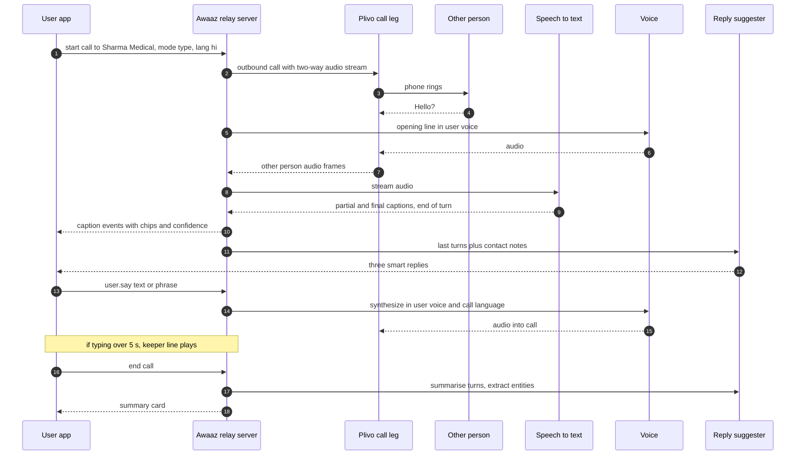
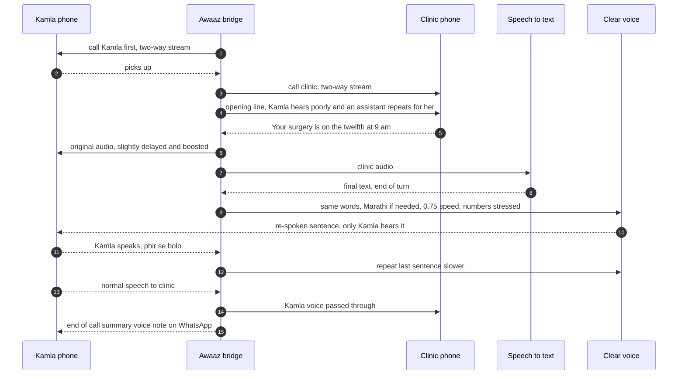
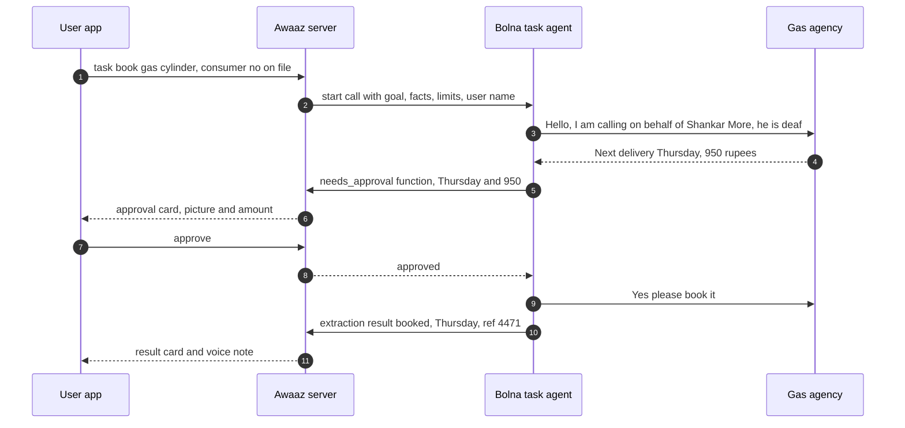
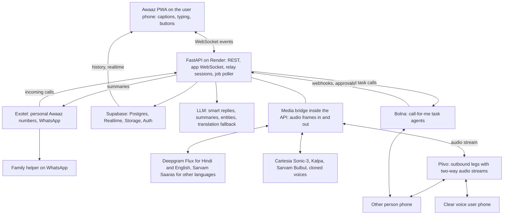
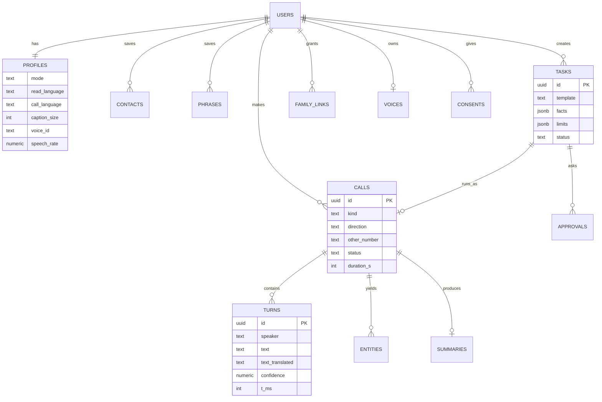

# Awaaz — Product requirements (PRD v0.1)

> Converted from `docs/prd-and-tech-design.html` (23 Oct 2026). **Read `docs/PRD-ADDENDUM-v2.md` next; it updates scope, talk/hear profiles, call paths and the WhatsApp bot.** The technical sections below are superseded by `docs/IMPLEMENTATION.md`.

Awaaz sits on the line. It speaks what you type, in your own voice. It shows you what the other person said, with the numbers picked out. It repeats things slowly for people who can’t hear well. And it can make the whole call for you.

**Submission line (183 characters)**
Awaaz makes phone calls possible for people who can’t hear or speak: it speaks what you type in your own voice, captions replies, repeats clearly, and can make the whole call for you.

PRD and technical design, v0.1, 23 October 2026. An alternative to Bhasha OPD for the Bolna Buildathon (due 31 October).

## Problem and evidence

Most of India still runs on phone calls: the pharmacy, the clinic, the bank, the gas agency, the delivery driver. For millions of people a phone call is either silent or unintelligible, and India has no relay service to help.

**18M** deaf people, by the National Association of the Deaf’s estimate — *The 2011 Census counted about 5 million*

**~15M** older adults with hearing loss who can still speak — *1 in 10 of 149M people aged 60+*

**4.3%** of older adults with hearing loss use a hearing aid — *LASI wave 1*

**0** national telecom relay services in India — *A long-standing ask from disability groups*

India has around 18 million deaf people and only about 250 to 350 certified sign language interpreters.
— *GSMA; National Association of the Deaf*

In the national ageing survey, about one in ten adults aged 60+ reported hearing loss, and only 4.3% of them used hearing aids.
— *LASI wave 1, 2017–18*

Hearing loss acquired after birth starts at a median age of 56, so most people with hearing loss learned to speak first.
— *NSS 76th round, 2018*

Disability groups have long flagged the lack of a national relay service as a gap in telecom access. TRAI recommended a relay centre for emergency calls in 2018; it has not been built.
— *CIS India; TRAI recommendations on ICT accessibility, 2018*

### The literacy reality, and why it shapes the product

Text relay (type and read) is how most countries serve deaf callers. In India it reaches only part of the need:

- Census 2011 recorded 56.9% of people with a hearing disability and 58.3% with a speech disability as literate, and about one in five of those literates had not finished primary school.
- There is no national data on how well deaf Indians actually read; researchers note many take years to reach a respectable level. Most of the 387 schools for deaf children still teach by lip-reading and speech rather than sign language.
- 56.5% of Indians aged 60+ never went to school (72.7% of women), so captions alone fail most older people with hearing loss.

**So Awaaz is voice-first, not text-first.** The largest group (older adults with hearing loss) can speak and needs *clear audio*, not captions. Literate deaf and speech-impaired users get type-to-speak with heavy shortcuts. People who can’t do a live call at all can hand the whole call to Awaaz. Sign language is served by handing off to human interpreters, not by pretending AI can do it today.

Rough reachable users from Census figures: about 2.3 million people with hearing disability and 0.9 million with speech disability at primary-level literacy or above, plus about 15 million older adults with hearing loss for clear voice, regardless of literacy.

## Who it serves

Kamla Deshmukh, 72

Pune. Marathi. Hard of hearing since her sixties. Never went to school. Speaks clearly.

**Today:** lets calls ring out, or hands the phone to a neighbour. Missed her eye surgery date because she misheard “twelfth” as “twentieth”.

**Needs:** to hear the other person slowly and clearly, and to have dates and numbers repeated.

Uses: Clear voice

Rafiq Shaikh, 54

Nagpur. Hindi and Urdu. Auto-rickshaw owner. Lost his voice box to throat cancer two years ago. Hears fine, reads Hindi.

**Today:** his teenage son makes every call for him: the bank, the RTO, customers.

**Needs:** to make his own calls, fast, in a voice that sounds like him.

Uses: Type to speak, My own voice

Priya Nair, 27

Mumbai. Deaf from birth. Uses Indian Sign Language. Reads English well, Hindi less. Graphic designer.

**Today:** WhatsApps everyone, but clinics, landlords and delivery drivers call. She can’t take those calls.

**Needs:** to type in English while the other person hears Hindi or Marathi.

Uses: Type to speak, Call for me

Shankar More, 66

Satara. Deaf since childhood, reads very little. Signs a village sign variety.

**Needs:** things done by phone without reading long text: a gas cylinder booked, a pension query answered.

Uses: Call for me with picture tasks; human interpreter handoff later

The other person on the call

Pharmacist, clinic receptionist, bank agent, delivery driver.

**Needs:** to understand within five seconds that this is a real person using an assistant, and not hang up.

Neha, Kamla’s daughter

Bengaluru. Sets things up for her mother.

**Needs:** to add contacts and phrases, and get a short summary of important calls, with her mother’s permission.

Uses: Family helper

## Four ways to call

One app, four modes. Awaaz suggests a mode during setup from one question (“How do you use the phone?”), and the user can switch any time.

#### Type to speak

For people who can’t speak or can’t hear, and can read.

Awaaz calls the number. You type or tap a phrase; the other person hears it spoken, in your chosen voice and language. Their reply appears as large captions with numbers, dates and names highlighted. Smart replies cut typing to a tap.

#### Clear voice

For people who can speak but can’t hear well, whether or not they read.

You talk normally. After the other person speaks, Awaaz says it again in your ear: slower, louder and clearer, in your language. Say “repeat”, “slower” or “what was the number?” any time. Big captions are optional.

#### Call for me

For anyone who can’t or doesn’t want to do the call live.

Pick a task with pictures or a sentence: refill medicine, book a doctor, book gas, ask a question. Awaaz makes the call itself, checks with you before agreeing to anything that matters, and sends back the result as a picture card and a voice note.

#### Incoming calls

For every mode.

Each user gets a personal Awaaz number to give to clinics, banks and contacts. Calls to it ring the Awaaz app with a flashing screen and vibration, and connect in the user’s mode.

## Features

Relay calls fail for predictable reasons: typing is slow, the other person hangs up, numbers get misheard, IVR menus can’t be navigated, and scammers target people who can’t hear well. Each feature below answers one of those failures.

### During a call

| Feature | What it does | Failure it prevents | Mode |
| --- | --- | --- | --- |
| **Smart replies** | After the other person speaks, three suggested replies appear (“Yes, please keep it ready”, “Can you deliver?”, “Please repeat”). One tap speaks it. | Typing is too slow for a live call | Type to speak |
| **Phrase board** | Saved phrases grouped by place: pharmacy, clinic, bank, home address, “I can’t speak, I’m typing”. | Re-typing the same things | Type to speak |
| **“Please hold” keeper** | When the user is typing for more than 5 seconds, Awaaz tells the other person “Rafiq is typing, please hold” so they don’t hang up. | Hang-ups during silence | Type to speak |
| **Honest opening line** | “Hello, this is Rafiq. He can’t speak, so an assistant is reading out what he types. Please talk normally.” | The other person thinks it’s a robocall | All |
| **Number and date chips** | Prices, dates, times, phone numbers, OTP requests and names are highlighted in captions. Tap a chip to save it or add a reminder. | Misheard numbers | Type to speak, Clear voice |
| **Repeat, slower, louder** | Re-speak the last thing the other person said, at 0.7× speed and higher volume. Voice commands work too: “phir se bolo”, “dheere”. | Missing what was said | Clear voice |
| **Ask them to repeat** | One tap makes Awaaz say “Sorry, could you please say that again?” to the other person. | Low-confidence captions | Type to speak, Clear voice |
| **Language bridge** | Type in English or romanised Hindi; the other person hears Hindi, Marathi, Tamil or English. Captions come back in the user’s reading language, with the original one tap away. | Deaf users who read English calling Marathi-speaking shops | Type to speak |
| **Keypad for menus** | IVR prompts appear as a list (“Press 1 for balance”); tapping an option sends the tone. | Getting stuck in phone menus | Type to speak |
| **Scam shield** | If the other person asks for an OTP, PIN, CVV or remote-access app, a red warning appears and Awaaz refuses to speak those digits. | Fraud targeting people who can’t hear well | All |
| **Confidence shading** | Words the system is unsure about are shown lighter, so the user knows when to ask again. | Trusting a wrong caption | Type to speak, Clear voice |

### Before and after a call

| Feature | What it does | Priority |
| --- | --- | --- |
| **Call for me** | Task templates with pictures (medicine refill, doctor appointment, gas booking, ask a question, call back a missed call). Awaaz makes the call, pauses for the user’s approval on prices or times, and reports back. | P0 |
| **Call summary card** | After every call: what was agreed, chips for dates, amounts and numbers, a 20-second voice note in the user’s language, and “add reminder” buttons. | P0 |
| **Personal Awaaz number** | A number the user gives to clinics and contacts. Incoming calls ring the app with flashing light and vibration. | P0 |
| **My own voice** | Record 1 minute, or upload old WhatsApp voice notes, to create a voice that sounds like the user. Only the user’s own voice, with a spoken consent sentence. | P1 (P0 if time allows; strongest demo moment) |
| **Contact notes** | “Sharma Medical: my BP medicine is Telma 40.” Awaaz uses these to pre-fill tasks and smart replies. | P0 |
| **Family helper** | A trusted family member can add contacts and phrases and, if the user allows it, receive call summaries on WhatsApp. | P1 |
| **SOS card** | One tap: alerts family with location, and shows a full-screen card to show someone nearby (“I am deaf. Please call my son: …”). Does not auto-call 112 in v1. | P1 |
| **Sign language handoff** | For ISL users who prefer it, a link to a human video interpreter service. | P2 |
| **Accessible business line** | Banks, hospitals and telecom companies give deaf customers an Awaaz-powered support number. | P2 (business model) |

## Flow: type to speak

1. **Pick a contact** Or type a number. Contact notes load.
2. **Awaaz dials** From a regular Indian number. App shows ringing.
3. **Opening line** Awaaz introduces the user and how the call works.
4. **Talk** Captions in, typed or tapped replies out, keeper fills silences.
5. **Summary** Card with agreed items, chips and reminders.



The user never joins the phone audio in this mode. The app is a live text console; the server owns the call.

## Flow: clear voice

Here the user does talk on the phone. Awaaz calls the user first, then the other person, and bridges them through the server so it can add a clear, slowed re-speak that only the user hears.



Voice commands are recognised only when they are short and match a known list, so normal conversation is never swallowed.

- **Re-speak, don’t rewrite.** By default Awaaz repeats the exact words, translated only if the user chose a different language. A “simpler words” option exists but always keeps numbers, dates, names and medicines exactly.
- **Numbers twice.** Dates, times and amounts are spoken twice and digit by digit for phone numbers (“nine, eight, two…”).
- **No reading needed.** The phone screen shows only three huge buttons: Repeat, Slower, End. Captions are optional.

## Flow: call for me

1. **Choose a task** Picture tiles, or say it in one sentence.
2. **Fill the gaps** Contact, item, preferred time. Contact notes pre-fill.
3. **Set limits**“Approve if under ₹500”, “mornings only”.
4. **Awaaz calls** Live progress; asks you before agreeing outside limits.
5. **Result** Picture card, voice note, reminder set.



The task agent may never share OTPs, PINs or card numbers, never agree to payments, and must hand back to the user on anything outside the stated goal.

## Flow: incoming calls

- Each user gets a **personal Awaaz number** (an Exotel virtual number) to share with clinics, banks and contacts.
- A call to that number reaches the Awaaz server. The caller hears: “You’ve reached Priya. She is deaf and uses Awaaz; please hold while she answers.”
- The app gets a push notification with a flashing full screen and strong vibration. If the app doesn’t answer in 30 seconds, Awaaz takes a message: it records the caller, transcribes, and shows it as a caption card.
- Clear voice users get a normal phone call from Awaaz on their own number, already bridged to the caller.
- Optionally, the user can forward unanswered calls on their own SIM to their Awaaz number with the carrier’s call-forwarding code (⚠️ verify per carrier).

## Flow: my own voice

For people who lost their voice, hearing it again is the most emotional moment Awaaz can offer, and the strongest demo.

1. The user (or family) uploads old voice notes or videos with the user speaking, or records 60 seconds if they still can.
2. The user confirms by typing a consent sentence; if they can speak, they read it aloud.
3. Awaaz creates a cloned voice with the voice provider and plays three samples. The user picks one or keeps a stock voice.
4. The voice is locked to that account. Cloning anyone else’s voice is not allowed and not offered.

If no recordings exist, the user chooses a stock voice by age, gender and region, and can adjust pitch and speed.

## Requirements

| ID | Requirement | Acceptance criteria | Priority |
| --- | --- | --- | --- |
| R1 | Onboarding with one question and mode suggestion; language, caption size, voice choice | New user reaches the home screen in under 90 seconds | P0 |
| R2 | Type-to-speak outbound call to any Indian number | Typed text heard by the other person within 1.2 s (p50) of tapping speak | P0 |
| R3 | Live captions with chips for numbers, dates, times, money, names, OTP requests | Caption appears within 1 s of the other person finishing a sentence (p50) | P0 |
| R4 | Smart replies and phrase board | Three suggestions shown within 1.5 s of end of turn; one tap speaks | P0 |
| R5 | Opening disclosure and “please hold” keeper | Every relay call opens with the disclosure; keeper plays after 5 s of silence while typing, at most every 8 s | P0 |
| R6 | Clear voice bridged call | Re-speak of each other-party turn reaches the user within 2 s of end of turn; Repeat and Slower work by button and voice | P0 |
| R7 | Call for me with templates, limits and approval checkpoints | Gas booking and medicine refill templates complete end to end; any value outside limits waits for user approval | P0 |
| R8 | Scam shield | OTP/PIN/CVV requests trigger a warning; Awaaz never speaks digit strings matching those patterns after such a request | P0 |
| R9 | Summary card after every call | Summary, chips, voice note and reminders within 10 s of hang-up | P0 |
| R10 | Language bridge (type English, they hear Hindi or Marathi) | Translation shown to the user before speaking when languages differ; original captions one tap away | P0 |
| R11 | Personal Awaaz number and incoming calls | Incoming call rings the app; message taken after 30 s | P1 |
| R12 | My own voice (cloning from recordings) | Consent captured; cloned voice used in calls | P1 |
| R13 | IVR keypad with spoken menu options as a list | Tapping an option sends the right DTMF tone | P1 |
| R14 | Family helper and SOS card | Family can add contacts; summaries shared only with consent | P1 |
| R15 | Sign language interpreter handoff; business lines | Partner integration | P2 |

## Safety and trust

#### The user’s words are the user’s

- Type to speak says exactly what the user typed. If translation or tidy-up is on, the final sentence is shown to the user before it is spoken.
- Smart replies are suggestions; nothing is spoken without a tap.
- Clear voice repeats the other person’s exact words by default. “Simpler words” never changes numbers, dates, names or medicines.

#### Honesty with the other person

- Every relay and task call opens by saying an assistant is involved and on whose behalf.
- Task calls never pretend to be the user. They say “calling on behalf of”.
- Calls are transcribed for the user; the opening line says so.

#### Fraud and impersonation

- Scam shield blocks speaking OTPs, PINs, CVVs and card numbers after the other party asks for them, and warns the user.
- Task agent: no payments, no sharing of credentials, no agreeing to anything outside the user’s limits.
- Voice cloning only of the account holder’s own voice, with a consent sentence; voices are never exportable.

#### Emergencies and privacy

- v1 does not place automated 112 calls. SOS alerts family with location and shows a full-screen card to show people nearby.
- Audio is not stored by default. Transcripts and summaries are kept for 30 days unless the user saves them.
- Family sees only what the user allows, and the user can revoke access any time.

## Architecture

The live relay needs full control over two audio streams, so Awaaz runs its own small media bridge on Plivo two-way audio streams. Fully automated task calls run on Bolna agents. Everything else is the same stack as Bhasha OPD: React, FastAPI and Supabase.



Two call paths: the live bridge (type to speak, clear voice) and Bolna task agents (call for me).

#### Frontend

- React + TypeScript + Vite, installable PWA, works on cheap Android phones.
- One WebSocket per live call for captions and actions; Supabase for history, contacts, phrases.
- Web Push for incoming calls and approvals; Vibration API and a flashing full-screen alert.
- Huge type scale (captions 24–40 px, user adjustable), 56 px minimum touch targets, high-contrast theme.

#### Backend

- Python 3.12, FastAPI, Pydantic v2, asyncio. Relay sessions are in-memory objects per call, checkpointed to Postgres.
- Media bridge handles Plivo audio-stream WebSockets (μ-law 8 kHz) and resamples for STT and TTS.
- Job poller on a Postgres `jobs` table for summaries, voice notes and task follow-ups.
- Render paid Starter instance recommended for the bridge: it holds long WebSockets and must not sleep.

## Real-time relay design

### Why not run the live relay on Bolna?

A Bolna agent decides what to say with an LLM after each turn. In a relay, a person decides, sometimes 10 seconds later, and sometimes without the other person having spoken. Bolna does support a custom LLM endpoint, so the “return the user’s typed text as the LLM reply” trick may work, but it fights the agent’s turn-taking and timeouts (⚠️ spike on day 1). Clear voice is impossible on a single agent leg because the re-speak must reach only the user. So the live relay uses a purpose-built bridge, and Bolna does what it is best at: fully automated calls.

### Session lifecycle

1. App opens `WS /v1/relay/{session_id}` and sends `call.start`.
2. API creates the Plivo call with an XML answer URL containing a bidirectional audio stream to `WS /v1/media/plivo/{leg_id}` (⚠️ verify Plivo bidirectional stream syntax and codec).
3. Media frames from the other person go to the STT stream. Flux gives end-of-turn events; Saaras streaming is used for Marathi and other languages.
4. On a final transcript: run entity tagging (regex + small LLM), push `caption.final`, then request smart replies.
5. On `user.say`: optional translation → TTS streaming → frames sent back on the leg. Outgoing audio is cancelled if the other person starts speaking (barge-in).
6. Keeper timer: if `user.typing` events continue for 5 s with nothing said, speak the keeper line once, then at most every 8 s.
7. On hang-up: flush, enqueue `summarise_call`, close WebSockets.

### Latency budget (p50 targets)

| Path | Steps | Target |
| --- | --- | --- |
| Other person → caption | end-of-turn detection 300–500 ms, final transcript 100–200 ms, push to app 50–100 ms | under 1 s |
| Tap → heard | WS 50 ms, translation 0–400 ms (only if needed), TTS first audio ~100 ms, telephony 150 ms | under 1.2 s |
| Other person → clear re-speak | end of turn 400 ms, transcript 200 ms, TTS first audio 100–300 ms | under 2 s |
| End of turn → smart replies | LLM with short context, 3 replies, max 12 words each | under 1.5 s |

### Clear voice audio mixing

- Two legs (user and other person), both streamed to the bridge. The bridge forwards each side’s audio to the other in real time.
- Toward the user only: the original audio is boosted and band-limited for speech clarity, then the re-spoken sentence plays after each turn. While a re-speak plays, the other person hears a soft tone so they know to wait.
- User voice commands (“repeat”, “slower”, “phir se”, “dheere”, “number kya tha”) are matched on short utterances only and are not forwarded to the other person.

## Voice stack and sponsor fit

| Need | Choice | Why |
| --- | --- | --- |
| Live captions, Hindi and English | Deepgram Flux | Built-in end-of-turn detection drives when to show captions, suggest replies and start a re-speak; handles Hindi-English switching |
| Live captions, other Indian languages | Sarvam Saaras v3 | Indian-language accuracy; speech-to-English mode for the language bridge |
| Speaking typed text fast | Cartesia Sonic-3 | Very low time to first audio; speed and emotion controls; voice cloning for “my own voice” |
| Clear voice re-speak | Kalpa | Instruction-following delivery: “slow, clear, stress the numbers”; Hinglish |
| Odia, Bengali and other voices | Sarvam Bulbul | Indian-language voices where others are missing |
| Live call legs | Plivo | Programmable outbound calls with two-way audio streams and DTMF |
| Personal numbers, WhatsApp | Exotel | Indian virtual numbers, incoming call webhooks, WhatsApp Business for summaries and family |
| Call for me | Bolna | Autonomous agents with functions, extraction and transfer |
| Smart replies, summaries, entities | Fast LLM with JSON output | Short prompts, strict schemas |

## Bolna task agents

One generic task agent per language, driven by variables. Templates only change the goal, the facts and the limits.

```
ROLE
You are Awaaz, calling on behalf of {user_name}, who is {disability_phrase} and cannot take this call.
Speak {call_language}. First sentence: "Hello, I'm an assistant calling on behalf of {user_name}."

GOAL: {goal}
FACTS YOU MAY SHARE: {facts}            # e.g. consumer number, medicine name, address
LIMITS: {limits}                        # e.g. "approve if price under 500 rupees", "weekday mornings only"

RULES
- Stay on the goal. If asked anything outside FACTS, say you'll check with {user_name}.
- Before agreeing to any price, date, time or change outside LIMITS, call needs_approval and wait.
- Never share OTPs, PINs, passwords, card or bank numbers. Never agree to pay.
- If transferred to an IVR, use the keypad function with the option that matches the goal.
- End politely once the goal is done or clearly impossible.
```

```
functions:
  needs_approval(session_id, question, options[])   -> waits up to 90 s for the user's answer (⚠️ verify Bolna function timeout)
  press_keys(digits)                                 -> DTMF (⚠️ verify Bolna support)
extraction (post-call):
  { "outcome": "done|partial|failed", "agreed": [{"what":"","value":""}],
    "reference_numbers": [], "next_steps": "", "summary_user_language": "" }
```

Templates at launch: medicine refill, doctor appointment, LPG cylinder booking, ask a question, call back a missed number.

## Data model



Row-level security: each user reads only their own rows; family links grant read access to summaries only.

## API and live events

| Endpoint | Purpose |
| --- | --- |
| `POST /v1/calls` | Create a relay session (mode, number, languages); returns session id and WebSocket URL |
| `WS /v1/relay/{session}` | App ↔ server live events |
| `WS /v1/media/plivo/{leg}` | Plivo two-way audio stream |
| `POST /v1/plivo/answer/{leg}` | Answer XML with the stream instruction |
| `POST /v1/tasks`, `POST /v1/tasks/{id}/approve` | Call for me |
| `POST /v1/webhooks/bolna`, `POST /v1/tools/needs-approval` | Task agent events and approval checkpoint |
| `POST /v1/webhooks/exotel/incoming` | Personal number inbound calls |
| `POST /v1/voices` | Upload samples and consent for my own voice |
| `GET /v1/calls/{id}/summary` | Summary card |

```
// server → app
{ "t": "call.state", "state": "ringing|connected|ended", "since_ms": 0 }
{ "t": "caption.partial", "turn": 7, "text": "haan mil jaayegi..." }
{ "t": "caption.final", "turn": 7, "text": "हाँ, मिल जाएगी। ₹420 होंगे…", "translated": "Yes, available. It’s ₹420…",
  "confidence": 0.91, "entities": [{"type":"money","text":"₹420"},{"type":"time","text":"शाम 6 बजे","iso":"18:00"}] }
{ "t": "suggestions", "turn": 7, "items": ["Theek hai, rakh dijiye", "Ghar par bhej sakte hain?", "Phir se boliye"] }
{ "t": "scam.warning", "reason": "otp_request", "turn": 9 }
{ "t": "keeper.spoken" }

// app → server
{ "t": "user.typing" }
{ "t": "user.say", "text": "Theek hai, rakh dijiye", "source": "suggestion|typed|phrase" }
{ "t": "user.ask_repeat" }        // asks the other person to repeat
{ "t": "user.respeak", "speed": 0.7 }   // clear voice: repeat to me
{ "t": "user.dtmf", "digits": "2" }
{ "t": "call.end" }
```

## Metrics

**<10%** calls where the other person hangs up in the first 30 s

**60%+** user turns sent with a smart reply or phrase

**<1.2 s** tap to heard, median

**80%+** call-for-me tasks completed without a human

Also track caption word error rate by language on consented test calls, re-speak requests per call (a proxy for clarity), and how many summaries lead to a saved reminder.

## Business model

#### Free for individuals

Users never pay to make a call. A daily fair-use limit keeps costs predictable. Funded by the two channels on the right, CSR and grants.

#### Accessible business lines

Banks, hospitals, insurers and telecom companies pay per minute for an Awaaz-powered support number for deaf and hard-of-hearing customers. The Department of Telecom’s 2025 accessibility instructions and the Rights of Persons with Disabilities Act make accessible customer service a compliance topic.

#### Government and NGOs

State disability departments, deaf associations and hearing-aid programmes distribute Awaaz numbers. A natural partner for the long-recommended national relay service.

Unit cost per relay minute is roughly telephony + speech-to-text + voice + a small LLM share. Use sponsor credits for the build and measure the real per-minute cost on the first 100 calls.

## 8-day build plan

Day 1 has one job: prove the hardest piece, two-way audio through the bridge.

Sat 24 Oct

Full day

- Plivo outbound call with two-way audio stream to FastAPI.
- Echo test, then TTS into the call, then Flux captions out.
- Spike: Bolna custom LLM relay (keep as plan B).

Sun 25 Oct

Full day

- App: home, contacts, live call screen with captions and typing.
- User.say → Cartesia → call. Opening line, keeper.
- Supabase schema, auth.

Mon 26 Oct

Evening

- Smart replies, phrase board, entity chips.
- Summary card after hang-up.

Tue 27 Oct

Evening

- Clear voice: two-leg bridge, re-speak with Kalpa, Repeat and Slower.

Wed 28 Oct

Evening

- Call for me on Bolna: gas and medicine templates, approval card.
- Scam shield.

Thu 29 Oct

Evening

- Language bridge (Saaras, translation).
- Real users: 3–5 deaf, hard-of-hearing or speech-impaired testers via a local deaf association or laryngectomee club, plus older relatives.

Fri 30 Oct

Evening

- My own voice (if a tester has old voice notes and consents).
- Demo page, video, deck.

Sat 31 Oct

Morning

- Fixes and submit before noon.

**Kill switch.** If two-way audio isn’t working by Sunday night, drop clear voice, build type to speak on the Bolna custom-LLM path, and make call for me the hero. If neither works by Monday, switch back to Bhasha OPD, which is fully specified and lower risk.

## Demo script, about 2 minutes

1. **0:00–0:15.** “India has no relay service. For 18 million deaf people and 15 million older adults who can’t hear well, a phone call is a wall.”
2. **0:15–0:50.** Rafiq’s phone: he taps Sharma Medical, types in romanised Hindi, taps smart replies. The pharmacist (on speaker) hears Hindi in Rafiq’s own voice. Captions show ₹420 and 6 pm as chips.
3. **0:50–1:15.** Kamla on clear voice: the clinic says “twelfth at 9 am”; Awaaz repeats it slowly in Marathi; she says “phir se bolo” and it repeats again.
4. **1:15–1:40.** Shankar taps the gas cylinder picture. Awaaz calls, asks him to approve ₹950, and returns a picture card with the date.
5. **1:40–1:55.** Scam shield: a fake “bank” asks for an OTP; a red warning, and Awaaz refuses.
6. **1:55–2:10.** Sponsor stack, real testers, and a live number a judge can call right now.

## Risks

| Risk | Impact | Mitigation |
| --- | --- | --- |
| Two-way audio streaming is harder than expected (codecs, timing, barge-in) | No live relay | Day-1 spike; kill switch to Bolna custom-LLM path; simplest codec (μ-law 8 kHz) end to end |
| Other people hang up on relay calls | Calls fail | Opening line tested with real shopkeepers; keeper; smart replies to cut silence |
| Caption errors on noisy shop calls | Wrong understanding | Confidence shading, “ask to repeat”, number chips double-checked by re-asking |
| Can’t recruit deaf testers in 8 days | Weak pitch | Contact a Pune deaf association, laryngectomee clubs and audiology clinics on day 1; older relatives for clear voice |
| Indian number KYC for personal numbers | No incoming calls | Incoming is P1; demo outbound only |
| Judges at a Bolna event see Bolna used only for tasks | Weaker sponsor story | Make call for me prominent; show the custom-LLM relay spike; explain why the live bridge is separate |
| Voice cloning misuse | Harm, trust | Own voice only, consent sentence, no export |

## Awaaz or Bhasha OPD?

| Question | Awaaz | Bhasha OPD |
| --- | --- | --- |
| Originality | Very high. No relay service exists in India. | High, but AI scribes exist nearby. |
| Demo moment | A man who lost his voice speaks again in his own voice. | A doctor’s brief writes itself from a call in Odia. |
| Build risk in 8 days | High. Custom real-time audio bridge. | Medium. Mostly Bolna agents plus a web app. |
| Use of Bolna | Task mode only (plus a spike). | Central to every call. |
| Use of other sponsors | All six, naturally. | All six, naturally. |
| Real users this week | Possible via deaf associations and older relatives; harder to schedule. | Easy for the prescription explainer; clinic needed for intake. |
| Who pays (YC question) | Businesses needing accessible support lines; grants. | Hospitals, clearly. |
| Social impact story | Very strong. | Strong. |

**Rule of thumb:** if you’re confident with real-time audio over WebSockets and can line up three real testers by Wednesday, Awaaz has the higher ceiling. If you want the safer, more Bolna-native build with a clear buyer, Bhasha OPD.

## Sources

- [Census 2011 disability literacy by type (RGI release, via Punekar News)](https://www.punekarnews.in/out-of-2-68-crore-total-disabled-population-in-india-54-5-are-literates/)
- [NSS 76th round literacy among persons with disabilities, Factly](https://factly.in/data-literacy-among-disabled-persons-just-over-50-far-below-national-average-as-per-76th-round-of-nss-report/)
- [Economic gradient of onset of disability in India (NSS 76th round)](https://www.ncbi.nlm.nih.gov/pmc/articles/PMC8061006/)
- [Self-reported hearing loss among older adults in India, LASI wave 1](https://repository.li.mahidol.ac.th/handle/123456789/86318)
- [LASI wave 1 factsheet: elderly in India](https://www.iipsindia.ac.in/sites/default/files/other_files/LASI_W1_Elderly_India.pdf)
- [India Ageing Report 2023 coverage, The National](https://www.thenationalnews.com/world/asia/2023/09/28/india-un-elderly-population/)
- [Deaf Education in India](https://www.researchgate.net/publication/331931105_Deaf_Education_in_India)
- [How India can evolve an inclusive policy for the deaf and hard of hearing, CodeBlue](https://codeblue.galencentre.org/2025/05/how-india-can-evolve-an-inclusive-policy-for-the-deaf-and-hard-of-hearing/)
- [Cambridge study on deaf children out of school, Careers360](https://news.careers360.com/recognise-indian-sign-language-official-language-cambridge-study-advises-indian-government)
- [On-demand sign language interpretation apps, GSMA](https://www.gsma.com/solutions-and-impact/connectivity-for-good/mobile-for-development/blog/making-sign-language-interpretation-accessible-for-all-through-mobile-assistive-technology/)
- [Accessibility in the New Telecom Policy, CIS India](https://cis-india.org/accessibility/accessibility-in-new-telecom.pdf/at_download/file)
- [TRAI recommendations on ICT accessibility, MediaNama](https://www.medianama.com/2018/07/223-trai-accessibility/)
- [DoT accessibility instructions 2025, AZB & Partners](https://www.azbpartners.com/bank/dot-releases-instructions-for-providing-telecom-services-to-persons-with-disabilities/)
- [Expert group meeting on aphasia, Annals of Indian Academy of Neurology](https://pmc.ncbi.nlm.nih.gov/articles/PMC6472241)
- [Epidemiological review of laryngeal cancer in India](https://pmc.ncbi.nlm.nih.gov/articles/PMC4743184)

Awaaz is a working name. People in this document are fictional composites. Hindi and Marathi lines need native-speaker review. Items marked ⚠️ need checking against provider documentation.
